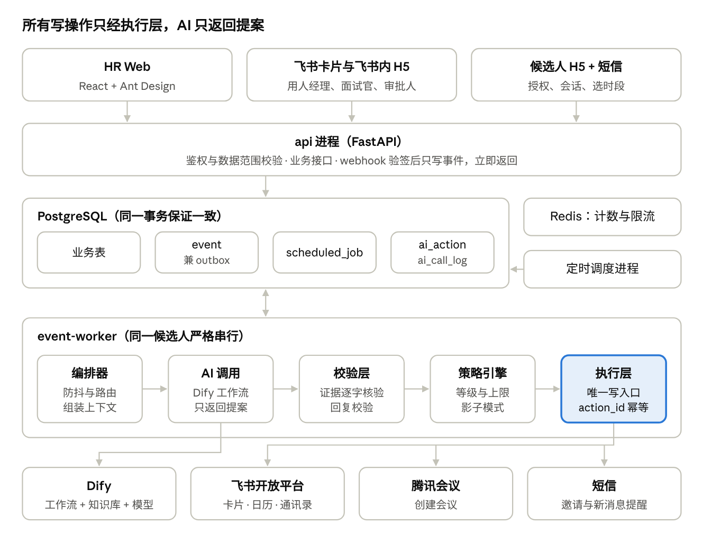
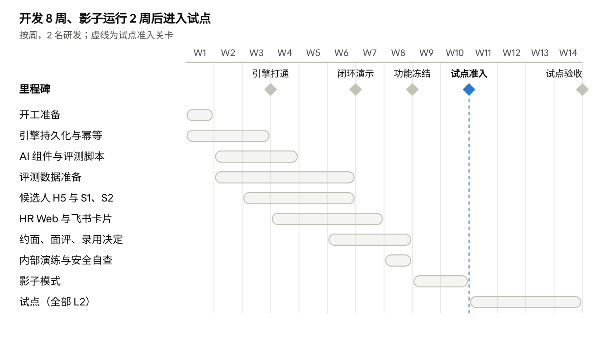

# AI 招聘官系统 MVP 实现规划

2026-11-05 · @vlas

## 概述

MVP 用 2 名研发、约 10 周，在 1 个试点部门的 2–3 个岗位上跑通一条闭环：候选人进来 → AI 沟通收集信息 → AI 评估 → HR 在决策卡上确认 → AI 约面 → 面评 → 用人经理决定录用。

本文依据《AI 招聘官系统 PRD V3.2》，回答三件事：MVP 做到哪里为止，用什么技术做，代码怎么分模块。PRD 与本文冲突时，业务规则以 PRD 为准，实现范围以本文为准。

**MVP 要验证的是 PRD 第 17 章那套 AI 引擎**，即“确定性编排 + AI 组件 + 校验 + 策略”在真实候选人身上是否可靠，而不是功能铺得全。所以页面和渠道能省则省，引擎部分按生产标准做。

**成功标准**（试点上线 4 周后验收）：

- 安全底线：AI 错误承诺、薪资泄露、受保护信息询问均为 0 次（按 AI 动作日志全量回查）。

- 可靠性：重复发送、重复执行为 0 次；消息状态未知的比例 \< 0.5%，且全部进入 HR 对账。

- 质量：AI 回答抽检准确率 ≥ 95%（PRD 正式目标 98%）；AI 评估与 HR 复核一致率 ≥ 80%（正式目标 85%）。

- 效率：候选人首次回复 ≤ 5 分钟；简历到评估结论在工作时间内 ≤ 2 小时。

- 使用：试点 HR 每天处理决策卡，不绕开系统。

## MVP 范围

MVP 只保留 PRD 第一期里支撑核心闭环的部分：AI 组件用 A3、A4、A5 三个，外加一个简化的“画像与 JD 草稿”调用；A2 寻源、A6 面试、A7 洞察留到下一阶段。

最大的取舍在渠道。BOSS直聘、智联的开放接口能力还没确认（PRD 19.2 写的是“以平台实际开放范围为准”），所以 **MVP 不依赖平台接口**：简历由 HR 从平台下载后导入，AI 沟通在自有的候选人 H5 里进行。平台接口确认后，作为一个渠道适配器接进来，引擎不用改。

| 模块     | MVP 做                                                                             | MVP 不做（替代方式）                                                   |
|----------|------------------------------------------------------------------------------------|------------------------------------------------------------------------|
| 招聘需求 | 手填表单；飞书卡片单级审批；审批通过生成岗位                                       | AI 填写、复制历史、AI 预检、多级审批流配置（审批人按部门写死在配置里） |
| 岗位     | 画像与知识库编辑；AI 生成画像和 JD 草稿；用人经理确认画像；暂停、关闭              | 渠道发布（HR 在平台手动发）；行内展开漏斗；挂人推荐                    |
| 候选人   | 简历上传与批量导入；A3 解析；按手机、邮箱去重；应聘记录状态机；候选人详情          | 疑似重复合并卡；人才库再激活；冷却期以外的跨岗位规则                   |
| AI 沟通  | 候选人 H5 会话（授权页 + AI 身份告知）；短信提醒；A4 + 回复校验；转人工与接管      | BOSS直聘、智联站内沟通（接口确认后接入）；微信小程序                   |
| AI 评估  | A5 三次采样；证据逐字核验；结论与把握度；决策卡                                    | 画像版本变更后的批量重评                                               |
| 面试     | 排期引擎 + 飞书日历；腾讯会议建会；面试官在飞书卡片写面评                          | AI 初面；转写与面评预填                                                |
| 录用     | 用人经理在飞书卡片做录用决定；单级录用审批；飞书消息移交 Offer 负责人；HR 回填结果 | 多岗位录用终止卡以外的联动                                             |
| 工作台   | HR 工作台：待决策、转人工、异常、AI 动态                                           | 岗位健康度、团队视图、每日抽检任务                                     |
| 业务端   | 飞书消息卡片；候选人精简视图（飞书内 H5）                                          | 业务 Web 工作台；HRBP、面试官专属页面                                  |
| 设置     | 自动化等级（全局 + 岗位）；公司通用知识库；飞书通讯录同步；角色手工配置；AI 总开关 | 字段模板、通知模板、数据保留策略界面（策略写在配置里）                 |
| 数据     | AI 运行指标页（采纳率、转人工率、校验拦截率、时延、成本）                          | 漏斗报表、问数、现有报表迁移                                           |

**一个必须做的开关：影子模式。** PRD 17.15 要求上线前影子运行 2 周，AI 只出结果、不执行不发送。这在策略引擎里是一个全局模式，成本很低，但没有它就过不了上线门槛，所以列入 MVP。

## 总体架构

架构就是 PRD 第 17 章的分层落到进程上：入口只写事件，worker 按候选人串行跑流水线，所有对外写操作只从执行层发出。



简历原件存对象存储，图上省略。五个关键决定：

1.  **模块化单体。** 一份代码、三类进程（api、event-worker、定时调度），模块边界靠依赖规则强制，而不靠拆服务。

2.  **PostgreSQL 一库多用。** 业务数据、事件、定时任务、幂等记录在同一库，“改状态 + 发事件 + 记动作”在一个事务里完成，不需要分布式事务。

3.  **写操作只有一个入口。** AI 调用模块拿不到任何写接口，只能产出提案，经校验和策略后由执行层落地。

4.  **Dify 只管“说什么”。** 提示词、模型和知识库放 Dify；状态、流程、定时、规则全部留在自己的代码里，换模型或改提示词绕不过策略引擎。

5.  **webhook 快进快出。** 外部回调只做验签和写事件，立即返回，慢的 AI 调用全在 worker 里，平台重试不会堆积。

部署分开发、预发布、生产三套环境，全部在境内云。预发布环境接 Dify 测试应用、飞书测试企业，用于影子模式之前的内部演练。

## 技术栈选型

后端选 Python，数据库和事件队列都用 PostgreSQL，AI 部分交给公司已有的 Dify。选型原则是：试点规模下尽量少引入中间件，但关键抽象（事件总线、渠道适配器、模型调用）留好接口，量上来时替换实现，不改业务代码。

| 层               | 选型                                                                            | 理由                                                                                                                                     |
|------------------|---------------------------------------------------------------------------------|------------------------------------------------------------------------------------------------------------------------------------------|
| 后端             | Python 3.12 + FastAPI + Pydantic v2                                             | PRD 验证包（编排器、策略引擎、校验层等约 1,000 行 + 58 个测试）就是 Python，可直接迁入；Pydantic 正好用来校验 AI 输出的 JSON             |
| ORM 与迁移       | SQLAlchemy 2.0 + Alembic                                                        | 成熟；支持乐观锁版本列和行级锁                                                                                                           |
| 数据库           | PostgreSQL 16（云托管版）                                                       | JSONB 存评估表和 AI 输出；`SKIP LOCKED` 和咨询锁可直接实现队列与候选人级串行；托管版自带备份，满足 RPO ≤ 15 分钟                         |
| 事件队列         | MVP：PostgreSQL 事件表 + outbox；之后：RocketMQ 或 Kafka                        | PRD 容量上限是 10 万条消息/天（约 1.2 条/秒），试点远低于此，Postgres 足够；事件与业务数据同库，写入天然原子；代码只依赖 `EventBus` 接口 |
| 缓存、防抖、限流 | Redis 7                                                                         | 候选人每日消息计数、短信与平台配额计数、接口限流（防抖计时放在 scheduled_job 表里，重启不丢）                                            |
| 定时任务         | 自建调度进程，扫描 `scheduled_job` 表                                           | 推迟发送、跟进、软占位过期都要跨天且不能因重启丢失，不用内存型调度器                                                                     |
| AI 编排          | Dify（自托管，工作流应用 + 知识库）                                             | PRD 17.12 已定；提示词可由产品和 HR 运营调整，不用发版                                                                                   |
| 模型             | 从公司 Dify 已接入的境内模型中按评测选：强模型一档、低成本模型一档              | PRD 20.4 要求数据不出境；具体型号由 A4、A5 评测集结果决定                                                                                |
| 简历转文本       | PyMuPDF + python-docx                                                           | 覆盖 PDF 和 Word；扫描件 OCR 放到下一阶段                                                                                                |
| HR Web           | React 18 + TypeScript + Vite + Ant Design 5（含 ProComponents）+ TanStack Query | 中后台以表格、表单为主，antd 的中文生态和组件最全                                                                                        |
| 移动 H5          | React + antd-mobile（候选人 H5 与飞书内 H5 共用）                               | 与 HR Web 同一个仓库，共享 OpenAPI 生成的接口客户端和类型                                                                                |
| 飞书             | 官方 SDK `lark-oapi`；消息卡片 JSON 2.0                                         | SSO、通讯录、日历、卡片回调都有现成封装                                                                                                  |
| 文件存储         | 阿里云 OSS 或腾讯云 COS（开发环境用 MinIO）                                     | S3 兼容接口；简历原件加密存储                                                                                                            |
| 短信             | 阿里云或腾讯云短信                                                              | 候选人提醒和验证码；主备切换下一阶段做                                                                                                   |
| 部署             | Docker Compose，境内云 2 台主机（应用、Redis 各一）+ 托管 PostgreSQL            | 试点阶段最省运维；正式推广再上 K8s                                                                                                       |
| 可观测           | structlog（JSON 日志）+ OpenTelemetry + Prometheus/Grafana + Sentry             | 链路追踪能把一次候选人消息从接入到发送串起来                                                                                             |
| 测试             | pytest + testcontainers（真 Postgres）；前端 Vitest + Playwright                | 引擎类测试必须跑在真数据库上，锁和事务行为才可信                                                                                         |

**刻意没选的：** 微服务（2 人团队维护成本过高，用模块化单体代替）；LangChain 之类的 Agent 框架（PRD 的设计是代码编排，框架反而增加不确定性）；向量数据库（知识库检索交给 Dify）。

## 工程结构与模块划分

一个仓库，后端是模块化单体：同一份代码，按进程类型部署成 3 种进程。模块边界按 PRD 第 17 章的分层来切，保证“AI 组件没有写权限”这条约束在代码结构上就成立。

    recruiter/
    ├── backend/
    │   ├── app/
    │   │   ├── core/            配置、数据库会话、飞书 SSO、权限（功能 × 数据范围）、审计、编号生成
    │   │   ├── domain/          业务对象与状态机，纯逻辑、不做 IO
    │   │   │   ├── requisition/  position/  candidate/  application/
    │   │   │   └── interview/    hire/      card/
    │   │   ├── engine/          PRD 第 17 章，从验证包迁入
    │   │   │   ├── events.py        事件定义 + EventBus 接口与 Postgres 实现
    │   │   │   ├── orchestrator/    事件处理（S1、S2、S3）、防抖、上下文组装
    │   │   │   ├── policy.py        策略引擎 decide()
    │   │   │   ├── validation/      入站快速判断、回复校验、评估后处理
    │   │   │   ├── confidence.py    把握度
    │   │   │   ├── executor.py      执行层：ai_action 状态机、outbox
    │   │   │   └── scheduling/      排期引擎（找时段、软占位、原子确认）
    │   │   ├── ai/              Dify 客户端、各组件的输入组装与输出解析、调用日志
    │   │   ├── integrations/    feishu/  tencent_meeting/  sms/  storage/
    │   │   │   └── channels/        渠道适配器接口；MVP 只有 manual_import 和 h5
    │   │   ├── api/             hr/  biz/  candidate/  webhooks/  admin/
    │   │   └── workers/         进程入口
    │   ├── migrations/
    │   └── tests/               unit/  engine/  integration/
    ├── frontend/
    │   ├── apps/hr-web/  apps/h5/
    │   └── packages/api-client/  packages/ui/
    ├── dify/                    导出的工作流 DSL 与提示词，随代码一起版本化
    ├── eval/                    评测集（脱敏）与评测脚本
    └── deploy/                  docker-compose、nginx、各环境配置

**依赖规则**（用 import-linter 在 CI 里强制）：

1.  `domain` 不依赖任何其他模块，不做数据库或网络调用。

2.  `engine` 只依赖 `domain` 和接口（端口）；飞书、Dify、短信由 `ai` 和 `integrations` 实现这些接口后注入。

3.  `ai` 只能返回结构化结果和动作提案，不能 import `executor`。这就是“AI 组件没有写权限”的代码级保证。

4.  对外的写操作（发消息、写日历、建会）只在 `executor` 里调用。

5.  `api` 只调用应用服务，不直接操作引擎内部。

**进程类型**

| 进程          | 实例数    | 做什么                                                                                                                       |
|---------------|-----------|------------------------------------------------------------------------------------------------------------------------------|
| api           | 2         | HR Web、H5、飞书卡片回调、外部 webhook；webhook 只做验签和写事件，立即返回                                                   |
| event-worker  | 2–4       | 消费事件表，按 `candidate_id` 加咨询锁保证同一候选人串行，跑编排器 → AI → 校验 → 策略 → 执行                                 |
| job-scheduler | 1（主备） | 扫描 `scheduled_job`：防抖到期、推迟发送、跟进、软占位过期、超时决策卡提醒、卡住动作回收                                     |
| outbox-relay  | 0         | MVP 不部署：事件表本身就是 outbox，与业务数据同一事务写入。换成 RocketMQ 或 Kafka 后才启用，负责把 outbox 记录转发到消息总线 |

## 数据模型

MVP 约 20 张表，分三组：业务对象、AI 与引擎、权限与审计。业务对象沿用 PRD 第 18 章的字段命名；引擎相关的 4 张表（`event`、`scheduled_job`、`ai_action`、`ai_call_log`）是 PRD 没细写、但幂等和回放必须依赖的。

| 表                               | 关键字段                                                                                                                      | 要点                                               |
|----------------------------------|-------------------------------------------------------------------------------------------------------------------------------|----------------------------------------------------|
| `requisition`                    | REQ 编号、需求部门、类型、人数、内部薪资带宽、状态、审批记录、version                                                         | 状态机按 PRD 5.1；已通过后不再变更                 |
| `position`                       | JOB 编号、状态、对外薪资区间、负责 HR、是否保密、当前画像版本、version                                                        | 可招人数是派生值，不存                             |
| `position_requisition`           | position_id、requisition_id                                                                                                   | 一个岗位可有多条来源需求                           |
| `position_profile`               | position_id、版本号、条目（id、类型：必备 / 加分 / 红旗、内容、权重）、确认人                                                 | 只追加新版本；评估记录引用的是版本号               |
| `kb_entry`                       | KB 编号、范围（公司通用 / 岗位）、内容、披露级别、Dify 文档 id、replaced_by                                                   | 修改即生成新编号、旧编号失效（PRD 17.7）           |
| `candidate`                      | 姓名、手机（加密 + 哈希）、邮箱（加密 + 哈希）、授权状态、不再联系标记                                                        | 用哈希列做去重唯一索引，明文只在加密列             |
| `candidate_sensitive`            | candidate_id、A3 解析出的受保护属性                                                                                           | 单独表、单独权限，永不进入评估上下文               |
| `resume`                         | candidate_id、文件键、全文、段落（R1…Rn）、解析字段、解析版本                                                                 | R 编号是证据逐字核验的基准                         |
| `application`                    | APP 编号、candidate_id、position_id、阶段、子状态、终止结果与原因、已收集字段（带来源消息 id）、补问轮次、关键候选人、version | 部分唯一索引：同一人同一岗位只能有一条进行中       |
| `message`                        | candidate_id、关联的 application_ids、方向、发送方类型、内容、kb_refs、ai_action_id、状态、计划发送时间                       | 一个候选人一个会话，多岗位合并                     |
| `evaluation`                     | application_id、画像版本、3 次原始采样、核验后的条目、结论、分数、把握、偏低原因、作废证据数                                  | 原始采样全量保留，用于评测回流                     |
| `interview`                      | IV 编号、application_id、轮次、状态、时段、面试官、会议链接、飞书日程 id                                                      | 状态机按 PRD 5.1                                   |
| `slot_hold`                      | 面试官、时段（tstzrange）、application_id、过期时间                                                                           | 用 PostgreSQL 排他约束防止同一面试官时段被重复占用 |
| `feedback`                       | interview_id、面试官、评价项、建议、提交时间                                                                                  | 面评只能由面试官本人提交                           |
| `hire_decision`                  | application_id、决定、审批人、移交状态、回填结果                                                                              | 回填“未接受 / 未入职”时可招人数回退                |
| `decision_card`                  | 类型、对象类型与 id、生成时对象版本、提案 action_id、建议、把握、理由、状态、时限、处理人、否决原因、飞书消息 id              | 同一对象同类型只留一张未处理卡（部分唯一索引）     |
| `event`                          | 事件类型、分区键、载荷（只含 id）、来源事件 id、状态、重试次数、可处理时间                                                    | 兼作 outbox；外部 event_id 唯一索引保留 7 天       |
| `scheduled_job`                  | 类型、关联对象、执行时间、状态、去重键                                                                                        | 去重键唯一，防止同一跟进被重复调度                 |
| `ai_action`                      | action_id（主键）、对象、动作类型、来源事件、状态、策略结果、对象版本、最终内容、外部引用                                     | 去重表 + 执行状态机 + 回放入口（见核心引擎一节）   |
| `ai_call_log`                    | action_id、组件、提示词版本、Dify 应用版本、模型、输入哈希与引用 id、原始输出、校验结果、耗时、token                          | 只追加                                             |
| `user`、`org_unit`、`role_grant` | 飞书用户与部门；角色 + 授权部门                                                                                               | 每日与飞书通讯录全量对账                           |
| `automation_setting`             | 范围（全局 / 序列 / 岗位）、环节、等级                                                                                        | 生效等级由策略引擎与硬性上限取小                   |
| `audit_log`                      | 操作人、动作、对象、前后值、时间                                                                                              | 只追加；数据库角色收回 UPDATE / DELETE 权限        |

**三条全局约定：**

- 所有业务对象带 `version` 列，写操作一律 `WHERE version = :v`，实现 PRD 5.9 的乐观锁和决策卡作废。

- 时间统一存 `timestamptz`（UTC），按用户时区展示；“工作日”计算用一张节假日表。

- 手机、邮箱、薪资字段用应用层加密（AES-GCM，密钥放云 KMS），满足 PRD 20.3 的字段级加密。

## 核心引擎实现

引擎是 MVP 里唯一按生产标准一次做到位的部分。起点是 PRD 验证包：编排器、策略引擎、回复校验、评估后处理、排期这几块已有可运行代码和 58 个测试，MVP 的工作是把它们从单进程内存版改成“Postgres 持久化 + 多 worker 并发”版，测试全部保留。

### 事件消费：同一候选人严格串行

worker 不是逐条抢事件，而是先抢一个候选人，再按顺序处理这个人的全部待处理事件：

``` python
def run_once():
    keys = db.scalars("""
        SELECT DISTINCT partition_key FROM event
        WHERE status = 'pending' AND available_at <= now()
        LIMIT 50""")
    for key in keys:
        with db.transaction():
            # 锁放在应用层逐个尝试，避免在 WHERE 里加锁时误锁多个候选人
            if not db.scalar("SELECT pg_try_advisory_xact_lock(hashtext(:k))", k=key):
                continue            # 另一个 worker 正在处理这个候选人
            for ev in db.events_of(key, status='pending', order_by='id'):
                handle(ev)          # 编排器入口
                ev.status = 'done'
            return
```

咨询锁随事务释放，worker 崩溃也不会死锁。岗位关闭这类跨候选人的事件按 `position_id` 分区，冲突交给版本号兜底。

### 防抖与定时

候选人消息到达时，只做两件事：落库 `message`，再对 `scheduled_job` 做一次 upsert（去重键 `debounce:{candidate_id}`，执行时间 = 现在 + 10 秒，来源 = 最新消息的 event_id）。10 秒内再来消息，只会把执行时间往后推。到期后产生 `candidate.reply_due` 事件，进入 S1 流程。

推迟发送、跟进、软占位过期、决策卡超时提醒都走同一张表，去重键用业务语义拼成（如 `followup:{app_id}:1`），重复调度天然无效。

### 一次处理的固定流水线

每个处理器都是同一个形状，以 S1 为例：

``` python
def on_reply_due(ev):
    ctx = context.build_a4(ev.candidate_id)          # 只取该候选人、该权限范围内的数据
    kb  = kb_search(ctx.position_ids, ctx.new_message) # 同一份结果给模型和校验
    out = ai.call('A4', ctx, kb)                      # 返回 JSON，ai 模块没有写权限
    res = validation.check_reply(out, kb, ctx)
    if not res.ok:
        out = ai.call('A4', ctx, kb, retry_reason=res.reasons)
        res = validation.check_reply(out, kb, ctx)
    for p in proposals.from_a4(out, res, origin=ev.origin_id):
        decision = policy.decide(p, ctx)               # EXECUTE / CARD / SUGGEST / DEFER / BLOCK / HANDOFF
        executor.apply(p, decision)
```

### 策略引擎

直接迁入验证包的 `decide()`，在最前面加一条：**全局模式为“影子”时，所有提案只记录为 SHADOW，不执行**。影子期每天由定时任务生成差异报告：AI 的提案 vs HR 实际做的操作。

### 执行层与幂等

按前面讨论过的方案实现：

- `action_id = sha256(对象类型, 对象 id, 动作类型, 区分键, 来源事件 id)`；推迟、决策卡确认、校验后重写都沿用原 ID。

- 内部写（改阶段、淘汰、建卡）在一个事务里完成：抢占 `ai_action` → 带版本号更新对象 → 写事件。严格一次。

- 外部写偏向“宁可少发、不可重发”：结果未知的动作标为 `unknown`，进 HR 对账，不自动重发。

MVP 选候选人 H5 作为沟通渠道有一个附带好处：**给候选人的回复只是写一条 `message` 记录，由 H5 拉取，属于内部写，天然严格一次**。真正的外部写只剩短信提醒、飞书卡片、飞书日程和腾讯会议建会。飞书发消息接口支持 `uuid` 参数去重，直接传 `action_id`；其余几项按“结果未知不重发”处理。

### 失败与降级

按 PRD 17.4、17.14 实现：模型调用重试 3 次（间隔 1、3、9 秒）；仍失败时对外消息不发、转人工；模型持续不可用超过 5 分钟，候选人收到预审定的固定话术（每人每天最多 1 次）。校验拦截率 1 小时内超过 20% 时，“回复候选人”自动降为 L2。管理员可以一键关闭任一组件。

### 测试

- 验证包的 58 个用例迁入 `tests/engine/`，改为跑在真实 Postgres 上。

- 新增并发与幂等用例：同一事件重复投递、两个 worker 抢同一候选人、执行中进程崩溃、决策卡双击确认、定时器重复调度、结果未知不重发。

- 端到端演练脚本：用模拟 Dify 返回跑完“提问 → 收齐 → 评估 → 推进 → 约面 → 确认”整条链路，作为每次合并前的冒烟测试。

## AI 组件实现

MVP 在 Dify 里建 5 个工作流应用，全部是“单次调用、输入输出固定”的形态，不用 Agent 应用。PRD 里 A1 是带工具的循环 Agent，MVP 先降级成一次调用生成画像和 JD 草稿，由人修改确认。

| 组件           | Dify 形态                                    | 模型档           | 输入                                                                        | 输出                                                                | 超时  |
|----------------|----------------------------------------------|------------------|-----------------------------------------------------------------------------|---------------------------------------------------------------------|-------|
| A3 简历解析    | 工作流                                       | 低成本、长上下文 | 已由代码切好段的简历（R1…Rn）                                               | 结构化字段 + 每个字段引用的 R 编号；受保护属性单独输出              | 30 秒 |
| A4 沟通        | 工作流                                       | 强               | PRD 17.7 的上下文：岗位信息、知识库检索结果、可选时段、对话摘要、最近 20 条 | reply、claims、field_updates、intents、time_preference、needs_human | 15 秒 |
| A5 评估        | 工作流，代码并行调用 3 次（temperature 0.7） | 强               | 画像条目、R 编号简历、相关对话                                              | 每条画像 meet / not_meet / unknown + 逐字证据 + 补问问题            | 60 秒 |
| 画像与 JD 草稿 | 工作流                                       | 强               | 需求字段、同部门历史岗位的画像                                              | 画像条目草稿、JD 草稿、建议补充的知识库问题                         | 30 秒 |
| 对话摘要       | 工作流                                       | 低成本           | 超过 20 条的旧消息                                                          | ≤ 300 字的事实与诉求                                                | 异步  |

**两处对 PRD 的小调整：**

1.  **简历分段由代码完成，不交给模型。** PRD 写的是 A3 输出段落编号。改成代码先按段落切分并编号，模型只负责抽字段、标注引用哪一段。这样 R 编号对应的原文 100% 是原件文字，A5 的证据逐字核验才有可靠的基准。

2.  **知识库检索在编排器里做**（PRD 17.12 已说明）：先调 Dify 知识库检索接口，按 `position_id` 过滤，再把结果同时交给 A4 和回复校验。需要先确认公司 Dify 版本是否支持元数据过滤；不支持就每个岗位建一个知识库。

### 调用封装（`ai` 模块）

所有组件走同一个入口 `call_component(name, inputs, action_id)`，它负责：

- 调用 Dify `workflows/run`，按组件设超时，失败按 1、3、9 秒重试。

- 用 Pydantic 模型解析输出；不是合法 JSON 时带错误信息重试 1 次。

- 写 `ai_call_log`：提示词版本、Dify 应用版本、模型、输入哈希与引用 id、原始输出、耗时、token。

- 按组件、岗位汇总成本，单日超预算 120% 告警。

每个组件在 Dify 里有“测试”“生产”两个应用（两个 API Key），配置里切换。

### 提示词与评测

- 提示词以 Dify DSL 导出到仓库 `dify/` 目录，改动走代码评审。A4、A5 直接用验证包里的完整提示词起步。

- `eval/` 下放评测脚本，对接 Dify 测试应用跑。提示词或模型一变就跑全量评测，任一指标下降超过 2 个百分点不得发布（PRD 17.15）。

- **评测数据是整个项目最长的一条线，第 1 周就要开始准备**：A5 每个试点序列 ≥ 200 份脱敏简历 + 当时 HR 的推进或淘汰结论；A4 ≥ 300 段脱敏对话 + ≥ 50 条对抗用例；A3 200 份人工标注简历。没有这些，上线门槛无从判断。

### 用量预估

按 PRD 17.13，一位进入沟通的候选人约消耗 7 万 token（A3 约 5.5K、A4 约 34K、A5 约 27K）。若试点每月 500 人进入沟通，约 3,500 万 token/月，金额待模型选定后按单价换算。

## 外部集成

MVP 真正依赖的外部系统只有飞书、短信、Dify 和对象存储；腾讯会议有替代方案，招聘平台完全不依赖接口。飞书企业自建应用的权限审批要找飞书管理员，流程可能要一两周，**第 1 周就要提交**。

| 系统           | MVP 用到的能力                                                                                                  | 接入方式                                                                         | 前置条件 / 待确认                                                          |
|----------------|-----------------------------------------------------------------------------------------------------------------|----------------------------------------------------------------------------------|----------------------------------------------------------------------------|
| 飞书           | 网页 SSO 与 H5 免登；通讯录同步；消息卡片（决策卡、需求审批、录用审批、面评、录用决定）；日历忙闲查询与创建日程 | 企业自建应用 + `lark-oapi`；通讯录走事件订阅 + 每日全量对账；卡片回调进 api 进程 | 应用权限审批；面试官日历授权（未授权时 PRD 要求 AI 先问面试官可用时间）    |
| 腾讯会议       | 创建会议                                                                                                        | 企业版 REST API                                                                  | 企业账号是否已开通 API；未开通前先用飞书日程自带的视频会议，或由 HR 填链接 |
| 短信           | 候选人邀请、新消息提醒、验证码                                                                                  | 阿里云或腾讯云短信                                                               | 签名与模板报备；模板文字用法务确认版                                       |
| BOSS直聘、智联 | 不接接口                                                                                                        | HR 从平台下载简历，在系统里批量导入（PDF、Word、zip）                            | 能否在平台沟通里发 H5 链接，要看平台规则；不能发就靠短信邀请               |
| Dify           | 5 个工作流应用、知识库检索                                                                                      | REST API，测试与生产两套 Key                                                     | 版本号；是否支持知识库元数据过滤；已接入的模型清单与 QPS 限制              |
| 对象存储       | 简历原件                                                                                                        | S3 兼容 SDK，服务端加密                                                          | 境内存储桶                                                                 |

### 候选人怎么进入 AI 沟通

1.  HR 在岗位上导入简历 → A3 解析 → 按手机、邮箱去重 → 建应聘记录，阶段为“AI 触达”。

2.  系统给候选人发短信邀请，附带签名的 H5 链接（链接带应聘记录和过期时间，无需注册）。

3.  候选人打开 H5：看到 AI 身份说明 → 授权页 → 同意后进入会话。

4.  **授权之后才跑 A5 评估**。PRD 20.4 规定“未授权不做 AI 评估”，而 S2 流程写的是简历进来立即评估，两者有冲突，MVP 按更严格的一条执行，需在评审时确认。

5.  候选人离开 H5 后，AI 有新回复时发短信提醒（受每人每天 2 条主动消息的限制）。

### 渠道适配器接口

平台接口确认后，只需新写一个适配器：

``` python
class ChannelAdapter(Protocol):
    name: str
    def capabilities(self) -> set[str]: ...           # publish / receive_resume / message
    def parse_webhook(self, req) -> list[Event]: ...  # 转成统一事件，带平台 event_id
    def send_message(self, to, text, idem_key) -> SendResult: ...
```

MVP 内置两个实现：`manual_import`（导入简历）和 `h5`（候选人 H5 会话）。平台只开放“发布 + 收简历”时，`capabilities()` 不含 `message`，编排器自动只在 H5 里沟通，符合 PRD 12.1 的约定。

## 前端与页面

MVP 共 17 个页面 + 6 种飞书卡片，其中 HR Web 13 页，PRD 的 23 页原型里大约做一半。业务方（用人经理、面试官、审批人）原则上不进 Web，全部在飞书卡片和飞书内 H5 完成，这也是 PRD 1.3“少打扰人”的原则。

| 端        | 页面                                                     | MVP 内容                                                                                            |
|-----------|----------------------------------------------------------|-----------------------------------------------------------------------------------------------------|
| HR Web    | HR 工作台（WB-01）                                       | 待决策 / 转人工 / 异常三个 tab；AI 动态（含撤销、纠正）；决策卡就地处理、批量确认（低把握不可批量） |
| HR Web    | 需求列表、发起、详情（RQ-01/02/03）                      | 手填表单；审批进度；生成的岗位                                                                      |
| HR Web    | 岗位列表、岗位详情（JB-01/02）                           | 详情含概览、候选人、面试、画像与知识库 4 个 tab；画像与 JD 由 AI 起草后编辑                         |
| HR Web    | 人才库、候选人详情（CD-01/02）                           | 详情含简历、AI 评估表（证据点击后在简历原文中高亮）、会话（接管与交还）、投递记录、操作记录         |
| HR Web    | 面试日程（IV-01）                                        | 列表视图；冲突与催评标记                                                                            |
| HR Web    | 设置：自动化策略、组织与权限、公司知识库（ST-01/03/05）  | 各环节等级；AI 组件总开关；影子模式开关；角色与授权部门                                             |
| HR Web    | AI 运行指标                                              | 采纳率、转人工率、校验拦截率、把握度分布、时延、成本                                                |
| 飞书内 H5 | 候选人精简视图（BZ-02）                                  | 推荐理由、风险、面评；联系方式脱敏                                                                  |
| 飞书内 H5 | 面评填写                                                 | 按面试流程的评价项填写                                                                              |
| 候选人 H5 | 会话（EX-01）                                            | AI 身份说明、授权页、聊天、进度、转人工入口                                                         |
| 候选人 H5 | 选面试时间（EX-02）                                      | 在会话里以卡片展示 4 个时段，点选即确认                                                             |
| 飞书卡片  | 需求审批、录用审批、决策卡、画像确认、面评提醒、录用决定 | 卡片内直接操作；任一处处理后其他入口同步失效                                                        |

**实现要点：**

- 视觉和交互以 PRD 4.5 的交互原型为准，HR Web 用 Ant Design 默认风格，不做额外设计。

- 决策卡的多入口同步（PRD WB-AC-01 要求 5 秒内）：卡片状态变更发事件，HR 工作台用 SSE 订阅刷新，飞书卡片调用更新卡片接口改为“已处理”。

- 候选人 H5 的新消息用 SSE 推送，断线时退回 5 秒轮询；微信内置浏览器要专门测。

- 前后端接口由 FastAPI 自动生成 OpenAPI，前端用 `openapi-typescript` 生成类型，两端字段不会对不上。

## 非功能：权限、审计、安全、可观测

权限和审计在 MVP 里按 PRD 全量实现，因为它们一旦漏掉，事后补很难，而且直接决定试点能不能过合规；性能和可用性按试点规模降级。

| 方面     | MVP 做法                                                                                                                                                  | 与 PRD 的差异                                                                    |
|----------|-----------------------------------------------------------------------------------------------------------------------------------------------------------|----------------------------------------------------------------------------------|
| 登录     | 内部用户飞书 SSO，会话 8 小时；候选人用签名链接 + 短信验证码                                                                                              | 无                                                                               |
| 权限     | 接口层统一校验“功能权限 × 数据范围”（PRD 3.2、3.3）：一个 `require(perm, scope_of=obj)` 依赖注入到每个路由；AI 以岗位负责 HR 的数据范围取数               | 角色由管理员手工配置，不做可视化权限编辑                                         |
| 保密规则 | 业务端联系方式脱敏；保密岗位只对指定人员可见；A4 上下文里不放内部薪资带宽和其他候选人信息                                                                 | 活水相关规则不涉及（MVP 不做活水）                                               |
| 审计     | 查看完整联系方式、下载简历、导出、强制操作、配置变更、AI 动作全部写 `audit_log`，只追加，保留 3 年                                                        | 无                                                                               |
| 加密     | TLS 1.2+；手机、邮箱、薪资字段级加密；简历原件服务端加密                                                                                                  | 无                                                                               |
| 个人信息 | 授权页；未授权不做 AI 评估；受保护属性单独存放；数据保留 3 年后匿名化（定时任务）                                                                         | 候选人查阅、更正、删除先由 HR 在后台代办，H5 自助入口放到下一阶段                |
| 性能     | 列表与详情 P95 ≤ 1.5 秒；AI 回复 P95 ≤ 30 秒；评估 P95 ≤ 2 分钟                                                                                           | 容量按试点设计（约 50 名内部用户、日均 2,000 条候选人消息），不做 2,000 并发压测 |
| 可用性   | 托管 PostgreSQL 自动备份（RPO ≤ 15 分钟）；AI 不可用时全部功能可人工完成                                                                                  | 不承诺 99.9%，单可用区部署                                                       |
| 可观测   | 每次候选人消息一条 trace（接入 → 防抖 → A4 → 校验 → 策略 → 发送）；按 `action_id` 回放整条链路；Grafana 看板：事件积压、AI 时延与错误率、校验拦截率、成本 | 无                                                                               |
| 告警     | 事件积压 \> 5 分钟、AI 错误率 \> 5%、校验拦截率 1 小时 \> 20%、`unknown` 状态动作出现、单日成本 \> 预算 120% → 飞书群                                     | 无                                                                               |

渗透测试和是否需要等保三级（PRD 20.3 待确认）放到全量推广前，不阻塞试点，但试点前要做一次内部安全自查：越权访问、批量导出、提示词注入。

## 迭代计划

从开工到试点准入共 10 周：开发 8 周，影子模式 2 周；之后试点 4 周做验收。PRD 一期建议是开发 12 周 + 试点 4 周，MVP 靠缩范围和复用验证包省出 4 周。



**人员**

| 角色               | 投入          | 负责                                          |
|--------------------|---------------|-----------------------------------------------|
| 后端研发           | 全职          | 引擎、数据模型、AI 调用、飞书与会议集成、部署 |
| 全栈研发（偏前端） | 全职          | HR Web、两类 H5、飞书卡片、业务接口           |
| 产品               | 半职          | 范围把控、提示词与知识库、影子期差异分析      |
| 测试               | 第 5 周起半职 | 端到端用例、对抗用例、微信与飞书内浏览器兼容  |
| 招聘运营           | 按需          | 评测数据、试点岗位的画像和知识库              |

**里程碑的验收口径**

1.  **引擎打通（第 3 周末）：** 用模拟 AI 输出跑通端到端演练脚本；验证包 58 个用例加并发幂等用例全部在 Postgres 上通过。

2.  **闭环演示（第 6 周末）：** 真实 Dify 调用下，导入简历 → 候选人 H5 对话 → 评估 → HR 在工作台确认决策卡；A4 对抗用例拦截率 100%。

3.  **功能冻结（第 8 周末）：** MVP 范围内功能全部可用；内部演练无 P0 缺陷；安全自查完成。

4.  **试点准入（第 10 周末）：** 影子期 AI 对外消息违规 0 起；A5 与 HR 一致率 ≥ 80%；误淘汰率 ≤ 3%。不达标则延长影子期，不进试点。

5.  **试点验收（第 14 周末）：** 达到概述里的成功标准，再决定哪些环节开 L3、下一阶段做 A2 寻源还是平台接口。

## 风险与开工前需确认的事项

工期风险几乎都来自研发控制不了的外部依赖，其中飞书权限、Dify 能力和评测数据三项不到位，MVP 就无法上线。下表的“最晚”按开工周计算。

| 事项                                                            | 为什么重要                              | 找谁                      | 最晚                     |
|-----------------------------------------------------------------|-----------------------------------------|---------------------------|--------------------------|
| PRD 验证包代码（约 1,000 行 + 58 个测试 + A4、A5 提示词）       | 引擎的起点，没有就要重写约 2 周的工作量 | 产品负责人                | 第 1 周                  |
| 飞书企业自建应用及权限                                          | SSO、卡片、通讯录、日历全靠它           | 飞书管理员 / IT           | 第 1 周提交，第 3 周到位 |
| Dify 版本、知识库元数据过滤、已接入模型与 QPS                   | 决定知识库怎么建、用哪个模型            | AI 平台负责人             | 第 1 周                  |
| 评测数据：每个试点序列 ≥ 200 份脱敏简历及 HR 结论；≥ 300 段对话 | 没有评测集就无法判断能否上线            | 招聘负责人 + 法务（脱敏） | 第 2 周启动，第 6 周到位 |
| 未授权候选人能否先做 AI 评估（S2 与 20.4 的冲突）               | 影响 S2 流程和候选人体验                | 产品 + 法务               | 第 2 周                  |
| 短信签名与模板报备                                              | 候选人邀请靠短信                        | 运营 / 法务               | 第 3 周                  |
| 腾讯会议企业 API 是否开通                                       | 不开通就用飞书视频会议替代              | IT                        | 第 4 周                  |
| 试点岗位、HR 与用人经理名单；编制表和职级薪资表                 | 配置试点数据                            | 招聘负责人                | 第 6 周                  |
| BOSS直聘、智联的开放范围与外链规则                              | 决定下一阶段能否接平台沟通              | 渠道管理员                | 不阻塞 MVP               |

**主要风险**

- **候选人不愿离开平台点 H5 链接，回复率低于平台内沟通。** 应对：短信文案做 A/B；HR 在平台沟通里同时发链接；把回复率作为试点指标，结果用来推动平台接口接入。

- **评测数据迟到。** 应对：影子模式期间 AI 与 HR 的差异记录本身就是评测数据，可以边跑边补。

- **两人团队工期紧。** 应对：引擎复用验证包；页面全用 Ant Design 默认组件；第 7 周末评估进度，必要时把 AI 运行指标页和人才库列表后移。

- **模型 JSON 输出不稳定、时延超标。** 应对：选模型时把结构错误率和 P95 时延列为硬指标；A4 时延超 12 秒的比例单独告警。
