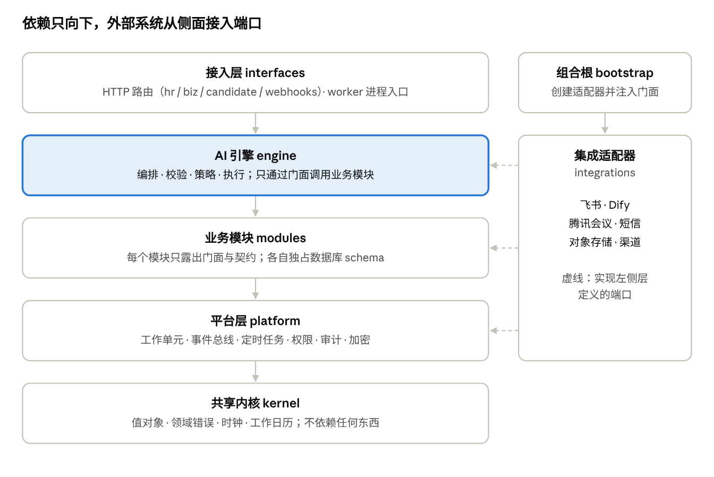
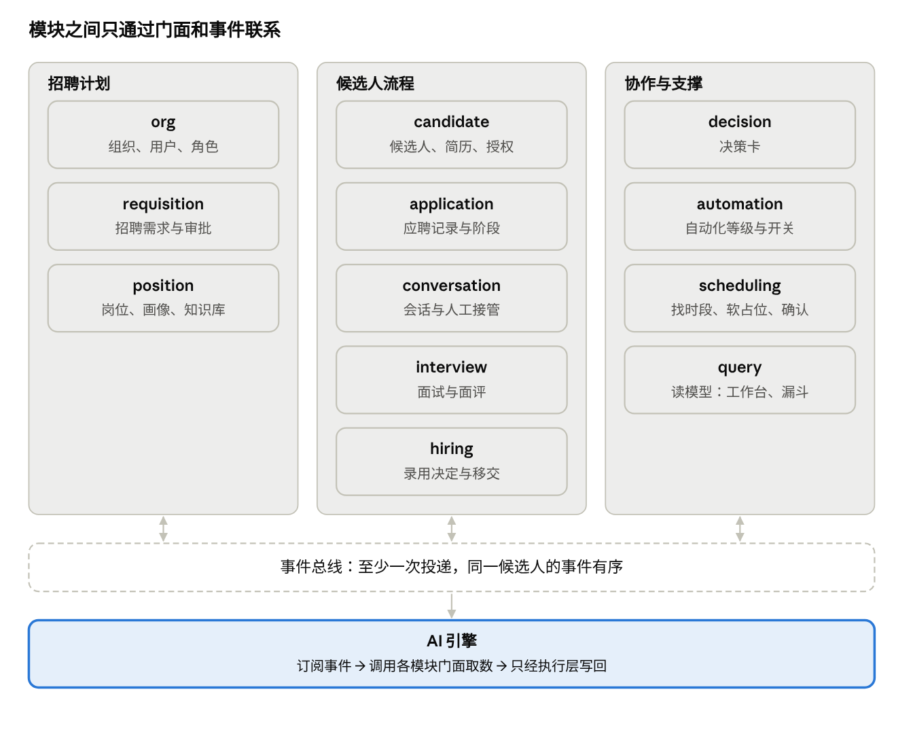
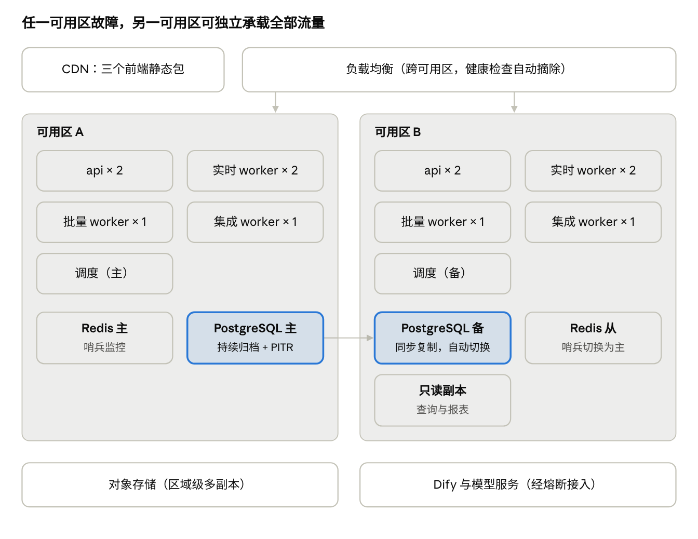

# AI 招聘官系统详细实现文档

Nov 5, 2026 · @vlas

## 概述

本文是 AI 招聘官系统的目标架构与编码规范：模块怎么切、每个模块对外暴露哪些函数、这些函数做什么、模块之间如何解耦，以及系统如何做到高可用和可扩展。研发按本文写代码，评审按本文查代码。

**与《MVP 实现规划》的关系。** 技术栈不变（Python + FastAPI、PostgreSQL、Redis、Dify、React）。MVP 是本文架构的第一个切片：模块边界、接口签名、事件契约从第一天就按本文实现，只是部分模块先用简化的适配器（例如事件总线先用 PostgreSQL 实现）。这样从 MVP 走到全量，替换的是适配器，而不是重写业务代码。

### 三个质量目标

| 目标 | 量化要求（PRD 第 20 章） | 主要手段 |
| --- | --- | --- |
| 高可用 | HR 端、业务端、候选人端月可用性 ≥ 99.9%；AI 能力 ≥ 99.5%；RPO ≤ 15 分钟，RTO ≤ 1 小时 | 无状态服务多副本跨可用区；数据库主备自动切换；事件至少投递一次 + 消费幂等；外部依赖限流、熔断、降级；AI 不可用时全部功能可人工完成 |
| 可扩展 | 内部并发用户 2,000；候选人消息 10 万条/天；候选人 500 万、应聘记录 1,000 万 | 读写按进程类型独立扩容；事件按候选人分区并行消费；事件总线、渠道、AI 组件都是可插拔的端口；模块可整体拆为独立服务 |
| 易维护 | 新增一个渠道或 AI 组件不改引擎代码；任一 AI 动作可回放 | 端口与适配器分层；模块只通过公开接口和事件通信；依赖规则由 CI 强制；契约测试；统一的日志、追踪与动作日志 |

### 怎么读本文

- 第 1–3 节是架构约定，所有研发都要读。
- 第 4–8 节是函数清单。清单里的函数是**模块的公开契约**：名称、参数、返回值和职责是规范，改动要走评审；模块内部的私有函数不在清单里，可自由实现。
- 函数签名用 Python 类型标注（前端用 TypeScript）；`Ctx` 表示调用上下文（当前用户、数据范围、追踪 id），`Uow` 表示工作单元（一个数据库事务）。
- 第 9–13 节是契约、高可用、扩展、开发规范和运维。
- 业务规则以 PRD V3.2 为准，本文不重复，只标注章节号。

## 架构原则与分层

后端分 5 层，依赖只能向下：上层可以调用任一下层，下层完全不知道上层存在。外部系统不在层里，而是从侧面实现各层定义的端口，由组合根统一装配。



六条架构原则，后文所有设计都从这里推出：

1. **依赖倒置（端口与适配器）。** 业务代码声明“需要什么能力”（端口），基础设施代码提供实现（适配器）。换飞书 SDK 版本、换短信服务商、换消息队列，都不碰业务代码。
2. **模块自治。** 每个业务模块拥有自己的数据和规则，只通过门面和事件与外界交互，可以独立测试，将来可以独立拆分。
3. **确定性优先。** 模型只负责“说什么、怎么判断”；什么时候做、能不能做、做不做，全部由可单测的代码决定（PRD 17.1）。
4. **副作用集中。** 写数据只发生在各模块的命令函数和引擎执行层；对外写（发消息、写日历）只发生在执行层，且全部幂等。
5. **命令与查询分离。** 写用例走主库与工作单元；读用例可走只读副本和读模型，读写可以分别扩容。
6. **处处可追溯。** 状态变更带版本号和操作记录，AI 动作带 `action_id` 可回放，敏感操作进审计。

## 模块地图

后端业务按 12 个模块切分，边界与 PRD 的业务对象一一对应。模块之间没有共享表，同步协作只调门面，后续动作只发事件；AI 引擎站在所有模块之上，订阅事件、调用门面。



| 模块 | 数据库 schema | 发布的主要事件 | 订阅的事件 |
| --- | --- | --- | --- |
| org | `org` | `org.user_left`、`org.dept_changed` | —（接飞书通讯录推送） |
| requisition | `req` | `requisition.submitted / approved / rejected / withdrawn` | `org.user_left` |
| position | `pos` | `position.created / published / paused / resumed / closed`、`kb.changed` | `requisition.approved`、`hire.approved`、`hire.result_recorded` |
| candidate | `cand` | `candidate.created / merged / consent_changed / do_not_contact / deleted`、`resume.received / parsed` | `candidate.deleted`（级联清理） |
| application | `app` | `application.created / stage_changed / ended / info_complete` | `position.closed`、`hire.approved`、`feedback.submitted` |
| conversation | `conv` | `candidate.message_received`、`conversation.taken_over / handed_back` | `candidate.deleted` |
| interview | `iv` | `interview.scheduled / rescheduled / cancelled / completed / no_show`、`feedback.submitted` | `application.stage_changed` |
| hiring | `hire` | `hire.approved / handed_over / result_recorded` | — |
| decision | `card` | `decision_card.created / resolved / invalidated` | `application.stage_changed / ended`、`position.closed` |
| automation | `auto` | `automation.changed` | — |
| scheduling | `sched` | `slots.held / released` | `interview.cancelled`、`position.closed` |
| query | `query` | — | 几乎全部事件（维护读模型） |
| engine | `engine` | 不直接发布；通过执行层调用门面，由各模块发布 | 消息、简历、信息收齐、阶段变化、决策卡处理、岗位状态、授权变化、定时到期 |

**允许的同步依赖**（门面调用）只有以下几条，其余一律走事件：

- 所有模块 → `org`（查人、查部门、算审批链）。
- `application` → `candidate`、`position`（创建应聘记录时校验候选人与岗位状态、冷却期）。
- `interview` → `scheduling`（确认时段时的原子占位）。
- `hiring` → `application`（录用审批通过时同一事务内推进阶段，唯一的强一致例外）。
- `engine` → 全部业务模块。

依赖没有环：新增一条同步依赖需要在 ADR 里说明为什么不能用事件。

## 后端模块内部结构规范

每个业务模块都按同一个目录模板组织，对外只露两样东西：一个门面（facade）和一组契约（DTO 与事件）。其他模块看不到它的实体、表和内部函数，这是后续能把任一模块拆成独立服务的前提。

### 目录模板

```
backend/app/modules/<模块名>/
├── __init__.py          只导出 public.py 与 contracts.py 中的名字
├── public.py            门面：本模块对外的全部同步函数（Protocol + 实现类）
├── contracts.py         对外 DTO、命令参数、领域事件的 Pydantic 定义（带版本号）
├── domain/
│   ├── model.py         实体与值对象（纯 Python dataclass，无 ORM 依赖）
│   ├── state.py         状态机：允许的迁移表 + transition() 纯函数
│   ├── rules.py         业务规则纯函数（如可招人数、冷却期判断）
│   └── errors.py        本模块的领域错误
├── application/
│   ├── commands.py      写用例：一个函数 = 一个事务 = 一个聚合
│   ├── queries.py       读用例：只读，可走只读副本
│   └── subscribers.py   订阅其他模块事件的处理函数（必须幂等）
├── ports.py             本模块依赖的外部能力（仓储、其他模块门面、外部服务）的 Protocol
├── adapters/
│   ├── repository.py    ports 中仓储的 PostgreSQL 实现（SQLAlchemy）
│   ├── orm.py           ORM 映射，只在本模块内可见
│   └── routes.py        本模块的 HTTP 路由（FastAPI APIRouter）
└── tests/               单元测试（domain）+ 用例测试（application，用内存仓储）
```

### 模块间通信的六条规则

1. **同步调用只走门面。** 模块 A 需要模块 B 的能力时，在 A 的 `ports.py` 里声明一个 Protocol，由组合根注入 B 的门面实现。A 的代码里不出现 `import modules.b.domain` 或 `modules.b.adapters`。
2. **每张表只属于一个模块。** 数据库按模块分 schema（`req`、`pos`、`cand`、`app`、`conv`、`iv`、`hire`、`card`、`org`、`engine`、`platform`），模块的数据库账号只能写自己的 schema。跨模块写数据一律通过对方门面或事件。
3. **跨模块的后续动作走事件。** 例如需求审批通过后生成岗位：`requisition` 只发布 `requisition.approved`，由 `position` 订阅并创建岗位。发布方不知道谁在订阅。
4. **一个命令只改一个聚合。** 跨聚合的一致性用事件实现最终一致；需要强一致的少数场景（录用审批通过时同时扣减可招人数）在函数说明里显式标注，并用同一事务内的门面调用完成。
5. **跨模块的列表查询用读模型。** 像“岗位列表 + 各阶段人数”这种需要多个模块数据的页面，由 `query` 模块订阅事件维护投影表，而不是在请求里连表跨 schema 查询。
6. **共享内核只放无业务含义的东西**：类型、编号、时间、错误基类、基础设施端口。任何带业务规则的代码都不能进共享内核。

### 组合根

`backend/app/bootstrap.py` 是唯一知道“谁实现了谁”的地方：按配置创建各适配器实例，注入到各模块的门面里，再交给 API 进程或 worker 进程。不引入 DI 框架，用普通函数手工装配，便于阅读和测试替换。

```python
def build_container(settings: Settings) -> Container:
    db = Database(settings.database)
    bus = make_event_bus(settings.event_bus, db)        # pg 或 kafka，由配置决定
    org = OrgFacade(OrgRepository(db), FeishuDirectory(settings.feishu))
    position = PositionFacade(PositionRepository(db), bus, org=org)
    ...
    return Container(org=org, position=position, ...)
```

### 依赖检查

用 `import-linter` 在 CI 里强制上述规则，违规即构建失败。核心约束：

```ini
[importlinter:contract:layers]
name = 分层
type = layers
layers =
    app.interfaces
    app.engine
    app.modules
    app.platform
    app.kernel

[importlinter:contract:module-privacy]
name = 模块只暴露 public 与 contracts
type = forbidden
source_modules = app.modules.*
forbidden_modules =
    app.modules.*.domain
    app.modules.*.adapters
    app.modules.*.application
allow_indirect_imports = True

[importlinter:contract:ai-no-write]
name = AI 网关不能调用执行层
type = forbidden
source_modules = app.engine.ai_gateway
forbidden_modules = app.engine.execution
```

（`module-privacy` 规则对模块自身目录豁免，由 import-linter 的 `ignore_imports` 配置每个模块的自引用。）

## 函数清单 · 共享内核与平台层

`kernel` 放无依赖的基础类型，`platform` 放所有模块共用的基础设施能力。业务模块只通过这里的函数访问数据库、事件、定时任务、权限和审计，不直接使用 SQLAlchemy 会话、Redis 客户端或消息队列 SDK——这样换底层实现时业务代码不动。

### kernel（无外部依赖）

| 函数 / 类型 | 功能 |
| --- | --- |
| `Clock.now() -> datetime` | 返回当前 UTC 时间；测试时注入固定时钟，所有业务代码禁止直接调用 `datetime.now()` |
| `WorkCalendar.add_workdays(start: datetime, n: int) -> datetime` | 按节假日表计算 n 个工作日后的时间（PRD 5.9 的“天”按工作日算） |
| `WorkCalendar.is_work_time(at: datetime, tz: str) -> bool` | 是否在工作时段，用于时限与提醒 |
| `TimeSlot(start, end)`、`SalaryRange(low, high, unit)`、`Ref(type, id)` | 值对象，不可变，自带校验 |
| `DomainError(code, message, details)` 及子类 `NotFound`、`Conflict`、`Forbidden`、`InvalidTransition`、`RuleViolation` | 统一错误基类；API 层按类型映射为 HTTP 状态码与错误码 |

### platform.db：数据库与工作单元

| 函数 | 功能 |
| --- | --- |
| `unit_of_work(ctx: Ctx) -> ContextManager[Uow]` | 开启一个事务；退出时提交，并把期间登记的事件写入 outbox；异常时回滚 |
| `Uow.add_event(event: DomainEvent) -> None` | 登记领域事件，与业务数据同一事务落库，保证“改数据”和“发事件”同时成功或同时失败 |
| `Uow.repo(repo_type: type[R]) -> R` | 取得绑定到本事务的仓储实例 |
| `read_session(ctx: Ctx) -> ContextManager[Session]` | 只读会话，路由到只读副本；用于查询用例和报表 |
| `update_versioned(table, id, expected_version: int, values: dict) -> int` | 带版本号条件的更新，返回新版本号；影响行数为 0 时抛 `Conflict`（PRD 5.9 乐观锁） |
| `next_business_no(kind: Literal['REQ','JOB','IV'], at: datetime) -> str` | 生成 REQ-202611-0042 这类编号，按月序列，事务内安全 |

### platform.events：事件总线

| 函数 | 功能 |
| --- | --- |
| `Envelope` | 事件信封：`event_id`、`type`、`schema_version`、`partition_key`、`occurred_at`、`origin_event_id`、`trace_id`、`payload`（只含对象 id 与必要状态，不含个人信息） |
| `EventBus.publish(envelopes: list[Envelope]) -> None` | 发布到总线；由 outbox 转发器调用，业务代码不直接调用 |
| `EventBus.subscribe(event_type: str, handler: Handler, group: str) -> None` | 注册订阅；同一 `group` 内一条事件只被处理一次 |
| `Consumer.run(group: str) -> NoReturn` | 消费循环：按 `partition_key` 串行处理，失败按 1、3、9 秒退避重试，超过 5 次进死信 |
| `OutboxRelay.run_once(batch: int = 500) -> int` | 把 outbox 记录转发到外部总线，返回转发条数；总线是 PostgreSQL 实现时为空操作 |
| `inbound_seen(source: str, external_id: str, ttl_days: int = 7) -> bool` | 外部回调去重（渠道 event\_id 等）；已见过返回 True |
| `DeadLetters.list(filters) -> Page` / `DeadLetters.requeue(event_id: str) -> None` | 查看与重放死信，运维后台使用 |

### platform.jobs：持久化定时任务

| 函数 | 功能 |
| --- | --- |
| `schedule(kind: str, run_at: datetime, ref: Ref, dedup_key: str, payload: dict) -> str` | 按去重键 upsert 一个任务；同一去重键重复调用不会产生两个任务 |
| `postpone(dedup_key: str, run_at: datetime) -> bool` | 把未执行的任务推后（10 秒防抖就靠它） |
| `cancel(dedup_key: str) -> bool` | 取消未执行的任务（如岗位关闭时取消排队的跟进） |
| `JobRunner.run_once(limit: int = 200) -> int` | 取出到期任务，转成事件发布；多实例下用 `SKIP LOCKED` 防止重复取 |
| `leader_lock(name: str) -> ContextManager[bool]` | 基于数据库咨询锁的主备选举，保证某些周期任务全局只跑一份 |

### platform.idempotency：幂等

| 函数 | 功能 |
| --- | --- |
| `action_key(obj: Ref, action_type: str, disambiguator: str \| None, origin_id: str) -> str` | 计算 AI 动作的 `action_id`（sha256）；推迟、确认、重写时沿用原值 |
| `request_key(user_id: str, action_type: str, obj: Ref, client_key: str) -> str` | 计算人工操作的幂等键，`client_key` 由前端每次打开操作时生成 |
| `idempotent(scope: str)`（FastAPI 依赖） | 读取请求头 `Idempotency-Key`；相同键 24 小时内重复请求直接返回首次结果 |

### platform.auth：身份

| 函数 | 功能 |
| --- | --- |
| `login_with_feishu(code: str) -> SessionToken` | 飞书 OAuth 回调换取用户身份，签发 8 小时会话 |
| `current_principal(token: str) -> Principal` | 校验会话，返回当前用户（含角色与授权部门的缓存） |
| `issue_candidate_link(application_id: str, ttl: timedelta) -> str` | 生成候选人 H5 的签名链接 |
| `verify_candidate_link(token: str) -> CandidatePrincipal` | 校验签名与过期时间 |
| `send_otp(phone: str) -> None` / `verify_otp(phone: str, code: str) -> bool` | 短信验证码，带频率限制 |

### platform.authz：权限与数据范围

| 函数 | 功能 |
| --- | --- |
| `require(perm: Permission, resource: ResourceLoader \| None = None)`（FastAPI 依赖） | 在接口层校验功能权限；带 `resource` 时同时校验数据范围（PRD 3.2、3.3），不通过抛 `Forbidden` |
| `can(principal: Principal, perm: Permission, resource: Ref \| None = None) -> bool` | 程序内判断，供门面和引擎使用 |
| `scope_of(principal: Principal) -> DataScope` | 解析数据范围：授权部门（含下级）、负责与共享的岗位、业务关系 |
| `DataScope.apply(stmt: Select, resource_type: str) -> Select` | 给查询语句追加数据范围条件，列表查询统一走这里 |
| `ai_principal(position_id: str) -> Principal` | AI 的身份：以岗位负责 HR 的数据范围工作（PRD 3.1） |
| `mask(value: str, kind: Literal['phone','email'], viewer: Principal) -> str` | 按查看人角色脱敏（PRD 3.4） |

### platform.audit、crypto、observability、resilience

| 函数 | 功能 |
| --- | --- |
| `audit(ctx: Ctx, action: str, obj: Ref, before: dict \| None, after: dict \| None, reason: str \| None) -> None` | 写审计日志，只追加（PRD 20.5） |
| `count_sensitive_access(user_id: str, kind: Literal['contact','resume']) -> int` | 统计当日查看联系方式、下载简历次数；超过阈值时告警并临时限制 |
| `encrypt(plaintext: str, purpose: str) -> bytes` / `decrypt(ciphertext: bytes, purpose: str) -> str` | 字段级加密（AES-GCM，数据密钥由 KMS 管理） |
| `blind_index(value: str, purpose: str) -> str` | HMAC 盲索引，用于加密字段的等值查询与去重（如手机号） |
| `get_logger(name: str) -> Logger` / `bind_log_context(**kv) -> None` | 结构化日志；自动带 trace\_id、用户 id、候选人 id |
| `span(name: str, **attrs) -> ContextManager` | OpenTelemetry 追踪片段 |
| `RateLimiter.acquire(key: str, limit: int, window: timedelta) -> bool` | Redis 令牌桶限流（平台配额、短信、模型 QPS） |
| `breaker(name: str).call(fn, *args) -> T` | 熔断器：连续失败超过阈值后快速失败，半开探测恢复 |
| `flags.is_on(flag: str, ctx: Ctx) -> bool` | 功能开关：影子模式、AI 组件开关、灰度岗位 |

## 函数清单 · 业务模块

下列函数是各模块 `public.py` 门面的全部公开函数。写函数第一个参数是 `ctx: Ctx`（谁在操作、以什么数据范围），修改已有对象的函数都带 `expected_version`；事件在函数内通过 `Uow.add_event` 登记，与数据同一事务提交。

### org：组织、用户与角色

职责：飞书通讯录的本地镜像、角色授权、审批人解析。

| 函数 | 功能 |
| --- | --- |
| `sync_directory_full() -> SyncReport` | 每日全量对账飞书通讯录：新增、变更、离职的人和部门 |
| `apply_directory_change(change: DirectoryChange) -> None` | 处理飞书推送的增量变更 |
| `get_user(user_id: str) -> UserDTO` / `dept_tree(root_id: str) -> DeptNode` | 查询用户、部门树 |
| `managers_of(dept_id: str, level: Literal['direct','skip']) -> list[UserDTO]` | 直属或隔级部门负责人 |
| `hrbp_of(dept_id: str) -> list[UserDTO]` | 对接该部门的 HRBP |
| `grant_role(ctx, user_id: str, role: Role, dept_ids: list[str]) -> None` / `revoke_role(...)` | 授予、收回角色及授权部门 |
| `resolve_approval_chain(kind: ChainKind, dept_id: str, facts: dict) -> list[ApprovalNode]` | 按审批流配置算出审批链（需求、录用），跳级规则也在这里判断 |

发布：`org.user_left`、`org.dept_changed`。

### requisition：招聘需求

职责：需求的起草、提交、审批与留痕（PRD 第 7 章）。不承载任何招聘执行。

| 函数 | 功能 |
| --- | --- |
| `create_draft(ctx, cmd: DraftInput) -> RequisitionDTO` | 新建草稿并分配 REQ 编号；代发起时记录用人经理 |
| `update_draft(ctx, req_id: str, patch: DraftPatch, expected_version: int) -> RequisitionDTO` | 修改草稿字段，记录字段来源（你的描述 / 通讯录 / 已修改…） |
| `precheck(ctx, req_id: str) -> list[PendingDecision]` | 必填、HC、薪资带宽、汇报对象检查，返回待决定项 |
| `submit(ctx, req_id: str, expected_version: int) -> RequisitionDTO` | 无待决定项时提交；计算审批链；代发起时第一个节点是用人经理确认 |
| `approve(ctx, req_id: str, node_id: str, comment: str \| None) -> RequisitionDTO` | 当前节点通过；全部通过时状态变为已通过 |
| `reject(ctx, req_id: str, node_id: str, reason: str) -> RequisitionDTO` | 驳回，原因必填 |
| `withdraw(ctx, req_id: str) -> RequisitionDTO` / `resubmit(...)` | 撤回；修改后重新提交从第一节点开始，保留历史 |
| `remind(ctx, req_id: str) -> None` | 催办当前节点审批人 |
| `get(ctx, req_id: str) -> RequisitionDetail` / `search(ctx, filters: ReqFilters, page: PageReq) -> Page[RequisitionRow]` | 详情与列表（自动套数据范围） |

发布：`requisition.submitted`、`approved`、`rejected`、`withdrawn`。订阅：`org.user_left`（审批人离职时转交）。

### position：岗位、画像、知识库、面试流程

职责：招聘的执行单元及其评价标准（PRD 第 8 章）。

| 函数 | 功能 |
| --- | --- |
| `on_requisition_approved(evt) -> None`（订阅） | 新增类需求生成岗位；追加类需求累加到已有岗位并在关闭时重开 |
| `publish(ctx, pos_id: str, expected_version: int)` / `pause(...)` / `resume(...)` / `close(ctx, pos_id, reason: CloseReason, ...)` | 岗位状态迁移（PRD 5.1）；发布前要求画像已确认 |
| `openings(pos_id: str) -> Openings` | 计划人数、已录用人数、可招人数（派生，不存储） |
| `save_profile(ctx, pos_id: str, items: list[ProfileItemInput]) -> ProfileVersion` | 保存画像为新版本（必备 / 加分 / 红旗、权重） |
| `confirm_profile(ctx, pos_id: str, version: int) -> None` | 用人经理确认画像 |
| `current_profile(pos_id: str) -> ProfileDTO` | 当前生效画像，供 AI 评估使用 |
| `add_kb_entry(ctx, scope: KbScope, pos_id: str \| None, content: str, disclosure: Disclosure) -> KbEntryDTO` | 新增知识库条目，同步到 Dify |
| `revise_kb_entry(ctx, kb_id: str, content: str) -> KbEntryDTO` | 修改即生成新编号，旧编号失效（PRD 17.7） |
| `retire_kb_entry(ctx, kb_id: str) -> None` | 下线条目 |
| `set_interview_plan(ctx, pos_id: str, rounds: list[RoundInput]) -> None` | 配置面试轮次、面试官组、时长、评价项 |
| `facts_for_ai(pos_id: str) -> PositionFacts` | AI 可见的岗位信息：对外薪资区间、地点、必问项；**不含内部薪资带宽** |
| `salary_guard(pos_id: str) -> SalaryGuard` | 内部带宽与对外区间，只给校验层使用 |
| `get(ctx, pos_id)` / `search(ctx, filters, page)` | 详情与列表 |

发布：`position.created`、`published`、`paused`、`resumed`、`closed`、`profile_confirmed`、`kb.changed`。订阅：`requisition.approved`、`hire.approved`、`hire.result_recorded`。

### candidate：候选人与简历

职责：一个自然人一条记录；简历、授权、去重、删除权（PRD 第 9 章、5.7、20.4）。

| 函数 | 功能 |
| --- | --- |
| `ingest_resume(ctx, file: FileRef, source: Source) -> IngestResult` | 存原件、转文本、按段落切分并编号 R1…Rn，发布 `resume.received` |
| `apply_parsed(resume_id: str, parsed: ParsedResume) -> CandidateDTO` | 写入 A3 解析结果；受保护属性写入独立表 |
| `match_identity(identity: Identity) -> DedupeResult` | 按手机 > 邮箱 > 姓名 + 学校 + 毕业年份匹配，返回自动合并或疑似重复 |
| `merge(ctx, primary_id: str, secondary_id: str) -> None` / `unmerge(ctx, merge_id: str) -> None` | 合并与 7 天内撤销合并 |
| `record_consent(cand_id: str, scope: ConsentScope, granted: bool) -> None` / `has_consent(cand_id, scope) -> bool` | 授权记录与查询；未授权不做 AI 评估 |
| `set_do_not_contact(cand_id: str, reason: str) -> None` / `contactable(cand_id: str) -> bool` | 不再联系标记 |
| `cooldown(cand_id: str, pos_id: str) -> CooldownInfo` | 冷却期判断（6 个月，同岗位与同序列同职级） |
| `resume_paragraphs(resume_id: str) -> list[Paragraph]` | R 编号原文，供评估与证据核验 |
| `get(ctx, cand_id: str, view: Literal['full','brief']) -> CandidateView` | 完整视图或业务端精简视图（联系方式脱敏） |
| `erase(ctx, cand_id: str) -> None` | 行使删除权：物理删除并级联通知各模块 |

发布：`candidate.created`、`merged`、`consent_changed`、`do_not_contact`、`deleted`；`resume.received`、`resume.parsed`。

### application：应聘记录

职责：一个人在一个岗位上的一次流程，招聘阶段状态机的载体（PRD 5.1）。

| 函数 | 功能 |
| --- | --- |
| `open(ctx, cand_id: str, pos_id: str, source: Source) -> ApplicationDTO` | 创建应聘记录；同一人同一岗位已有进行中记录时抛 `Conflict` |
| `transition(ctx, app_id: str, to: Stage, reason: str, expected_version: int) -> ApplicationDTO` | 按状态迁移表推进；表外迁移抛 `InvalidTransition` |
| `end(ctx, app_id: str, result: EndResult, reason: str, expected_version: int) -> ApplicationDTO` | 终止（淘汰 / 放弃 / 岗位关闭 / 未接受 / 未入职），记录阶段与原因 |
| `record_fields(app_id: str, updates: list[FieldUpdate]) -> None` | 写入沟通中收集到的字段，每个值带来源消息 id |
| `missing_items(app_id: str) -> list[RequiredItem]` | 还缺的必问项和 A5 补问问题；为空时发布 `application.info_complete` |
| `add_questions(app_id: str, questions: list[str]) -> int` | 加入补问问题，返回当前补问轮次（上限 2 轮） |
| `mark_key(ctx, app_id: str, is_key: bool) -> None` | 标记关键候选人（所有对外动作最高 L2） |
| `active_for(cand_id: str) -> list[ApplicationDTO]` | 某候选人所有进行中的应聘记录（A4 多岗位合并沟通用） |

发布：`application.created`、`stage_changed`、`ended`、`info_complete`。订阅：`position.closed`（终止在途记录）、`hire.approved`（为其他进行中记录生成“是否终止”卡）。

### conversation：会话与消息

职责：每个候选人一个会话，多岗位合并；人工接管（PRD 6.3）。

| 函数 | 功能 |
| --- | --- |
| `append_inbound(cand_id: str, channel: str, content: str, external_id: str) -> MessageDTO` | 记录候选人消息并发布 `candidate.message_received` |
| `queue_outbound(cand_id: str, content: str, kb_refs: list[str], action_id: str, send_at: datetime) -> MessageDTO` | 写入待发送消息（H5 渠道即为送达） |
| `mark_delivered(msg_id: str, external_ref: str)` / `mark_failed(msg_id: str, error: str)` | 外部渠道的投递结果 |
| `recent(cand_id: str, n: int = 20) -> list[MessageDTO]` / `summary(cand_id: str) -> str` | 最近消息与更早对话的摘要 |
| `take_over(ctx, cand_id: str)` / `hand_back(ctx, cand_id: str)` / `taken_over(cand_id: str) -> bool` | 接管与交还；接管中 AI 只出草稿 |
| `save_draft(cand_id: str, content: str, action_id: str) -> None` | 保存给 HR 的草拟回复 |

发布：`candidate.message_received`、`message.delivered`、`conversation.taken_over`、`handed_back`。

### interview：面试与面评

| 函数 | 功能 |
| --- | --- |
| `create_round(app_id: str, round_no: int) -> InterviewDTO` | 进入面试阶段时为下一轮建面试记录（状态：待约） |
| `confirm_slot(ctx, iv_id: str, slot: TimeSlot, expected_version: int) -> InterviewDTO` | 确认时段；内部调用排期引擎做原子占位，成功后发布 `interview.scheduled` |
| `reschedule(ctx, iv_id: str, reason: str)` / `cancel(ctx, iv_id: str, reason: str)` / `mark_no_show(iv_id: str)` | 改期、取消、候选人缺席 |
| `submit_feedback(ctx, iv_id: str, items: list[FeedbackItem], recommendation: str) -> None` | 面试官本人提交面评；全部面评提交后推进到用人部门评估 |
| `feedback_overdue(now: datetime) -> list[InterviewDTO]` | 超时未交面评的面试，供催评任务使用 |
| `schedule_view(ctx, filters, page)` | 面试日程列表 |

发布：`interview.scheduled`、`rescheduled`、`cancelled`、`completed`、`no_show`、`feedback.submitted`。

### hiring：录用决定与移交

| 函数 | 功能 |
| --- | --- |
| `decide(ctx, app_id: str, decision: HireDecision) -> HireDTO` | 用人经理做录用决定（只能由人调用，AI 身份调用直接拒绝） |
| `approve(ctx, hire_id: str, node_id: str) -> HireDTO` | 录用审批；全部通过时同一事务内推进应聘记录到“已录用”，可招人数随之减少 |
| `hand_over(hire_id: str) -> None` | 生成移交单并通过飞书发给 Offer 流程负责人 |
| `record_result(ctx, hire_id: str, result: HireResult) -> None` | HR 回填已接受 / 未接受 / 已入职 / 未入职；后两种失败结果回退可招人数 |

发布：`hire.approved`、`handed_over`、`result_recorded`。

### decision：决策卡

职责：所有“需要人决定”的事项（PRD 5.3、6.2），各入口共享同一张卡。

| 函数 | 功能 |
| --- | --- |
| `open_card(spec: CardSpec) -> CardDTO` | 生成决策卡；同一对象同类型已有未处理卡时返回原卡 |
| `resolve(ctx, card_id: str, option: str, reject_reason: str \| None) -> Resolution` | 处理卡片：校验对象版本仍一致，返回待执行的动作（沿用原 `action_id`） |
| `invalidate(card_id: str, reason: str)` / `invalidate_for(obj: Ref, types: list[CardType], reason: str)` | 对象状态变化后作废不再成立的卡 |
| `open_cards(ctx, filters, page) -> Page[CardDTO]` | 当前用户可见的未处理卡，按时限、关键候选人、紧急度排序 |
| `handle_overdue(now: datetime) -> int` | 超时卡片按规则提醒或升级，**不执行建议动作** |

发布：`decision_card.created`、`resolved`、`invalidated`。订阅：`application.stage_changed`、`application.ended`、`position.closed`（作废相关卡）。

### automation 与 query

| 函数 | 功能 |
| --- | --- |
| `automation.configured_level(node: Node, pos_id: str) -> Level` | 按全局 → 序列 → 岗位取配置等级（硬上限由策略引擎再取小） |
| `automation.set_level(ctx, scope: Scope, node: Node, level: Level) -> None` | 修改配置并审计 |
| `automation.mode() -> Literal['normal','shadow','manual']` / `component_enabled(name: str) -> bool` | 全局模式与 AI 组件开关 |
| `query.workbench(ctx) -> WorkbenchView` | HR 工作台首屏：概览数字、待处理计数、AI 动态 |
| `query.position_funnel(pos_id: str) -> Funnel` | 岗位各阶段人数与转化率（读模型，事件驱动更新） |
| `query.on_event(evt) -> None`（订阅） | 维护以上投影表；可整体重建 |

## 函数清单 · AI 引擎

引擎实现 PRD 第 17 章，由 9 个子模块组成（另有排期模块位于业务模块层，供引擎和 interview 共用）。它们之间是一条单向流水线：编排器组装上下文 → AI 网关取回结构化结果 → 校验层核验 → 生成提案 → 策略引擎决定 → 执行层落地。除执行层外，其余子模块都**不写任何业务数据**；可扩展点（AI 组件、校验规则、策略规则、动作类型）都通过注册表接入，新增时不改流水线代码。

### engine.orchestrator：编排器

| 函数 | 功能 |
| --- | --- |
| `register(bus: EventBus) -> None` | 把下列处理函数注册到事件总线，消费组 `engine` |
| `on_message_received(evt) -> None` | 入站快速判断（退订、要求人工直接处理）；其余消息调用 `jobs.schedule/postpone` 做 10 秒防抖 |
| `on_reply_due(evt) -> None` | S1：组装 A4 上下文 → 调 A4 → 回复校验（不过则带原因重写 1 次）→ 生成提案 → 策略 → 执行 |
| `on_resume_received(evt) -> None` | S2 前半：调 A3 → 写解析结果 → 去重 → 建应聘记录；已授权则触发评估 |
| `on_info_complete(evt) -> None` | S2 后半：A5 三次采样 → 后处理 → 把握度 → 按结论生成推进 / 淘汰 / 补问提案 |
| `on_stage_changed(evt) -> None` | 进入面试时：排期引擎找时段并软占位 → A4 把时段写成话术 |
| `on_card_resolved(evt) -> None` | 决策卡被确认后，用原 `action_id` 交执行层；被否决时记录原因回流评测集 |
| `on_deferred_due(evt) -> None` | 推迟的动作到期：**重新走一遍策略引擎**，再交执行层 |
| `on_position_status_changed(evt) -> None` | 岗位暂停或关闭：取消排队的主动触达与跟进，作废相关决策卡，释放软占位 |
| `on_consent_changed(evt) -> None` | 候选人授权后补跑评估；撤回授权后停止 AI 评估 |

### engine.context：上下文组装

| 函数 | 功能 |
| --- | --- |
| `build_a4(cand_id: str, new_messages: list[MessageDTO]) -> A4Input` | 按 PRD 17.7 组装：各进行中岗位的阶段与待收集项、知识库命中、可选时段、对话摘要、最近 20 条；**刻意排除**内部薪资带宽、评估结论、HR 备注、其他候选人信息 |
| `build_a5(app_id: str) -> A5Input` | 当前画像版本 + R 编号简历 + 与该岗位相关的对话；不含受保护属性和其他岗位的评估 |
| `build_a3(resume_id: str) -> A3Input` | 已切段的简历文本 |
| `build_profile_draft(pos_id: str) -> ProfileDraftInput` | 需求字段 + 同部门历史画像 |
| `retrieve_kb(position_ids: list[str], query: str, k: int = 8) -> KbHits` | 检索候选人所在岗位 + 公司通用知识库；同一份结果给模型和校验层 |
| `refresh_summary(cand_id: str) -> None` | 对话超过 20 条时用低成本模型压缩旧消息（异步任务） |

### engine.ai\_gateway：AI 网关

| 函数 | 功能 |
| --- | --- |
| `register_component(spec: ComponentSpec) -> None` | 注册一个 AI 组件：名称、Dify 应用（测试 / 生产）、输入输出 Pydantic 模型、超时、模型档。新增组件只需注册，不改网关 |
| `call(name: str, inputs: BaseModel, action_id: str, retry_reason: list[str] \| None = None) -> ComponentResult[T]` | 调用组件：超时与 1、3、9 秒重试、熔断、JSON 解析（不合法带错误重试 1 次）、写 `ai_call_log` |
| `sample(name: str, inputs: BaseModel, n: int, temperature: float, action_id: str) -> list[ComponentResult[T]]` | 并行采样 n 次（A5 用 3 次） |
| `health() -> GatewayHealth` | 各组件的熔断状态与错误率；持续不可用超过 5 分钟时进入降级 |
| `cost_report(day: date) -> CostReport` | 按组件、岗位统计 token 与成本 |

### engine.validation：校验层

| 函数 | 功能 |
| --- | --- |
| `inbound_check(text: str) -> InboundVerdict` | 正则判断退订、要求人工，不调模型，保证 100% 生效 |
| `check_reply(reply: A4Output, env: ReplyEnv) -> ValidationResult` | 依次执行已注册的回复规则，汇总失败原因；`env` 含知识库命中、对外区间、内部带宽、是否首条消息、其他候选人姓名表 |
| `register_reply_rule(rule: ReplyRule) -> None` | 注册回复规则；内置 8 条：`rule_length`、`rule_ai_identity`、`rule_no_protected_questions`、`rule_no_promise`、`rule_claims_in_kb`、`rule_benefit_terms_in_kb`、`rule_salary_in_range`、`rule_no_other_candidates`（PRD 17.10） |
| `normalize_cn_numbers(text: str) -> str` | 中文数字改写（“一万三”→ 13K），只在薪资上下文中参与判定 |
| `postprocess_evaluation(samples: list[A5Output], profile: ProfileDTO, sources: SourceTexts) -> Evaluation` | 结构校验 → 证据逐字核验 → 受保护信息剔除 → 注入检测 → 按固定公式算结论与分数 |
| `verify_quote(quote: str, source_text: str) -> bool` | 去空白后判断引用是否为原文子串；对不上的证据作废、该条降为 unknown |
| `detect_injection(text: str) -> bool` | 检测简历或消息中的指令注入 |

### engine.confidence：把握度

| 函数 | 功能 |
| --- | --- |
| `compute(main: Evaluation, samples: list[Evaluation], self_conf: float) -> Confidence` | 0.5 × 一致率 + 0.3 × 覆盖率 + 0.2 × 模型自评，有作废证据再 × 0.8；返回数值与偏低原因（PRD 17.11） |
| `band(value: float) -> Literal['high','mid','low']` | 按可配阈值分档（默认 0.85 / 0.6） |

### engine.proposals：提案生成

| 函数 | 功能 |
| --- | --- |
| `from_a4(out: A4Output, check: ValidationResult, origin: str) -> list[Proposal]` | 把 A4 输出拆成提案：发送回复、写字段、意向处理（放弃卡、改约、转人工） |
| `from_evaluation(ev: Evaluation, app: ApplicationDTO, origin: str) -> list[Proposal]` | advance → 推进提案；reject → 淘汰提案；need\_info → 补问；hold → 推进提案并把握压到 0.59 |
| `Proposal` | 字段：`action_id`、对象、动作类型、区分键、来源事件、载荷、把握、是否对外、是否已校验 |

### engine.policy：策略引擎

| 函数 | 功能 |
| --- | --- |
| `decide(p: Proposal, ctx: PolicyContext) -> Decision` | 按顺序执行已注册的策略规则，第一个命中的决定结果：EXECUTE / CARD / SUGGEST / DEFER / BLOCK / HANDOFF / SHADOW；不调用模型 |
| `load_context(p: Proposal) -> PolicyContext` | 一次性取齐判断所需事实：岗位状态、候选人授权与不再联系、关键候选人、配置等级、发送计数 |
| `register_policy_rule(rule: PolicyRule, order: int) -> None` | 注册规则；内置顺序：影子模式 → 只能人做 → 数据范围 → 岗位状态 → 不再联系 → 未校验文本 → 校验失败 → 未授权 → 计算等级 → 发送时间与频次 → 按等级分流 |
| `effective_level(p: Proposal, ctx: PolicyContext) -> Level` | 配置等级与硬性上限取小；关键候选人、保密岗位、低把握、疑似注入一律最高 L2 |
| `next_send_time(kind: MsgKind, cand_tz: str, now: datetime, last_inbound: datetime \| None) -> datetime \| None` | 发送时间窗口与宽限规则（PRD 5.6）；返回 None 表示可立即发送 |

### engine.execution：执行层

| 函数 | 功能 |
| --- | --- |
| `apply(p: Proposal, d: Decision) -> ActionRecord` | 唯一写入口：登记 `ai_action`，按决定直接执行、生成决策卡、登记推迟任务或只记录 |
| `register_action(action_type: str, handler: ActionHandler) -> None` | 注册动作处理器；每个处理器声明自己是内部写还是外部写 |
| `execute(action_id: str) -> ActionRecord` | 抢占动作（状态条件更新）→ 调用处理器；内部写同事务完成，外部写结果未知时标为 `unknown` |
| `cancel(action_id: str, reason: str) -> bool` | 取消尚未执行的动作（如候选人发了新消息，丢弃旧的推迟回复） |
| `recover_stuck(older_than: timedelta) -> int` | 回收停在“执行中”的动作：内部写改回可执行，外部写转 `unknown` |
| `reconcile_unknown() -> int` | 对 `unknown` 动作向外部系统对账；查不到结果的生成 HR 异常 |
| `replay(action_id: str) -> ActionTrace` | 按 `action_id` 返回完整链路：触发事件、上下文引用、AI 原始输出、校验、策略、执行结果 |

内置动作处理器：`SendReply`、`RecordFields`、`AdvanceStage`、`RejectApplication`、`OpenCard`、`HoldSlots`、`BookInterview`、`SendSms`、`NotifyFeishu`。

### modules.scheduling：排期（业务模块层，引擎与 interview 共用，避免下层调用上层）

| 函数 | 功能 |
| --- | --- |
| `find_slots(round: RoundSpec, now: datetime, n: int = 4) -> list[TimeSlot]` | 按面试官飞书忙闲、工作时段、缓冲、每日上限、节假日找共同空闲；最早不早于 26 小时后，尽量分布在不同天 |
| `hold(app_id: str, slots: list[TimeSlot], ttl: timedelta) -> list[str]` | 软占位 24 小时（数据库排他约束防重叠） |
| `match(pref: TimePreference, app_id: str) -> TimeSlot \| None` | 把候选人的选择或偏好匹配到已占位时段 |
| `book(app_id: str, slot: TimeSlot) -> BookingResult` | 原子确认：时段仍空闲才成功，成功后释放其余占位 |
| `release(app_id: str) -> int` | 释放该应聘记录的全部软占位 |

### engine.monitors：自动降级与报表

| 函数 | 功能 |
| --- | --- |
| `watch_reply_block_rate() -> None` | 1 小时内回复校验拦截率 > 20% 时，把“回复候选人”降为 L2 并通知管理员 |
| `watch_override_rate() -> None` | 某序列 7 天滚动否决率 > 25% 时，该序列 AI 推进降为 L1 |
| `shadow_diff_report(day: date) -> Report` | 影子模式下 AI 提案与 HR 实际操作的差异报告 |
| `daily_spot_check(day: date) -> list[str]` | 从前一工作日的 L3 动作中抽取抽检样本（优先把握 0.6–0.75） |

## 函数清单 · 外部集成适配器

每个外部系统先在业务侧定义一个**端口**（Protocol），再由适配器实现。业务模块和引擎只认识端口，不认识飞书 SDK 或 Dify 的 HTTP 接口；换供应商、加主备、写测试替身，都只动适配器。

### 端口定义

| 端口与函数 | 功能 |
| --- | --- |
| `DirectoryPort.list_departments() -> list[DeptRecord]` / `list_users(dept_id: str) -> list[UserRecord]` | 读取组织与人员（飞书通讯录） |
| `DirectoryPort.parse_change(req: Request) -> DirectoryChange` | 解析通讯录变更推送 |
| `MessengerPort.send_card(to: list[str], card: CardPayload, idem_key: str) -> MsgRef` | 发送交互卡片；`idem_key` 传 `action_id`，飞书用 `uuid` 去重 |
| `MessengerPort.update_card(ref: MsgRef, card: CardPayload) -> None` | 更新已发卡片（处理后变为“已处理”） |
| `MessengerPort.parse_card_action(req: Request) -> CardAction` | 解析卡片按钮回调：谁、点了哪张卡的哪个选项 |
| `CalendarPort.free_busy(user_ids: list[str], window: TimeSlot) -> dict[str, list[TimeSlot]]` | 查询忙闲 |
| `CalendarPort.create_event(spec: EventSpec, idem_key: str) -> EventRef` / `update_event(...)` / `cancel_event(ref: EventRef)` | 写入、修改、取消面试日程 |
| `MeetingPort.create(subject: str, slot: TimeSlot, host: str, idem_key: str) -> Meeting` / `cancel(meeting_id: str)` | 创建与取消视频会议 |
| `SmsPort.send(phone: str, template: str, params: dict, idem_key: str) -> SendResult` / `status(ref: str) -> DeliveryStatus` | 发送模板短信、查询回执（用于对账） |
| `FileStorePort.put(key: str, data: bytes, content_type: str) -> FileRef` / `get(ref)` / `presign(ref, ttl)` / `delete(ref)` | 文件存取；下载走短时签名链接 |
| `TextExtractor.extract(file: FileRef) -> str` / `split_paragraphs(text: str) -> list[Paragraph]` | 简历转文本、确定性切段 |
| `WorkflowPort.run(app: AppRef, inputs: dict, timeout: float) -> dict` | 运行一个 Dify 工作流，返回原始输出 |
| `KnowledgePort.retrieve(datasets: list[str], query: str, k: int, filters: dict) -> list[KbHit]` / `upsert(dataset: str, doc_id: str, text: str, meta: dict)` / `delete(...)` | 知识库检索与同步 |
| `ChannelAdapter.capabilities() -> set[Capability]` | 声明能力：发布职位、收简历、站内沟通 |
| `ChannelAdapter.parse_webhook(req: Request) -> list[Envelope]` | 验签并把平台回调转成统一事件（带平台 event\_id） |
| `ChannelAdapter.send_message(to: ChannelUser, text: str, idem_key: str) -> SendResult` | 通过渠道给候选人发消息 |
| `ChannelAdapter.publish_job(job: JobPosting) -> PublishResult` / `fetch_resume(ref: str) -> FileRef` | 发布职位、拉取简历 |

### 适配器实现

| 适配器 | 实现的端口 | 说明 |
| --- | --- | --- |
| `integrations.feishu` | Directory、Messenger、Calendar | 基于 `lark-oapi`；租户令牌缓存在 Redis，提前 5 分钟刷新 |
| `integrations.dify` | Workflow、Knowledge | HTTP 客户端（httpx），连接池；测试 / 生产两套 Key 按配置切换 |
| `integrations.tencent_meeting` | Meeting | 企业版 REST API；未开通时由 `FeishuVcMeeting` 实现同一端口 |
| `integrations.sms` | Sms | `AliyunSms`、`TencentSms` 两个实现，由 `FailoverSms([主, 备])` 组合成主备切换 |
| `integrations.storage` | FileStore | `OssStore`、`CosStore`、`MinioStore`（开发） |
| `integrations.extract` | TextExtractor | PyMuPDF、python-docx；扫描件 OCR 作为后续实现 |
| `integrations.channels.manual_import` | ChannelAdapter | 批量导入简历，只有“收简历”能力 |
| `integrations.channels.h5` | ChannelAdapter | 候选人 H5 会话；发送即写消息表，属于内部写 |
| `integrations.channels.boss`、`zhilian` | ChannelAdapter | 平台接口确认后实现，按平台实际开放的能力声明 `capabilities()` |

### 所有适配器共同遵守

1. **只做协议转换，不含业务规则。** 输入输出用 kernel 里的 DTO，不把 SDK 对象泄漏到适配器外。
2. **统一的韧性包装。** 每次外部调用默认超时 5 秒、重试 3 次（指数退避，仅对幂等或带幂等键的调用重试）、按适配器名熔断、按配额限流（PRD 19.3）。
3. **回调验签。** `verify_signature(req)` 校验签名与时间戳（5 分钟窗口），失败直接 401，不进入业务。
4. **健康检查。** 每个适配器实现 `health() -> HealthStatus`，汇总到 `/health/integrations`；5 分钟窗口失败率 > 5% 告警。
5. **测试替身与契约测试。** 每个端口提供一个内存实现（`FakeCalendar`、`FakeMessenger`…），用例测试默认用替身；同一套契约测试同时跑在替身和真实沙箱上，保证替身的行为与真实系统一致。

## 前端架构与模块

前端是一个 pnpm + Turborepo 的 monorepo：3 个可独立构建、独立部署的应用，共用 10 个基础包。应用内部按业务功能切片，功能之间不互相引用内部代码，规则与后端模块一致，由 ESLint 在 CI 里强制。

### 目录

```
frontend/
├── apps/
│   ├── hr-web/            HR 端（React + Ant Design）
│   ├── biz-h5/            飞书内 H5：业务方精简视图、面评、审批详情（antd-mobile）
│   └── candidate-h5/      候选人端：授权、会话、选时段（antd-mobile，适配微信内置浏览器）
└── packages/
    ├── api-client/        由后端 OpenAPI 生成的类型与请求函数；统一错误处理与幂等键
    ├── auth/              飞书 SSO、飞书 H5 免登、候选人链接登录
    ├── permissions/       权限判断 hooks 与组件（只控制显示，真正的校验在后端）
    ├── domain/            跨应用共享的枚举、状态文案、格式化函数、查询键
    ├── realtime/          SSE 订阅、断线重连与轮询降级
    ├── ui-kit/            基于 antd 的业务组件
    ├── mobile-ui/         基于 antd-mobile 的业务组件
    ├── telemetry/         埋点（PRD 21.2），不含个人信息
    ├── i18n/              文案；首期简体中文，结构支持英文
    └── config/            ESLint、TypeScript、Vite 公共配置
```

### 应用内分层（以 hr-web 为例）

```
apps/hr-web/src/
├── app/          路由、全局 Provider、布局、错误边界
├── pages/        页面：只做组装，把功能模块拼起来
├── features/     业务功能切片：workbench、requisition、position、candidate、interview、settings、insights
│   └── <功能>/
│       ├── index.ts      唯一出口：路由定义 + 对外组件
│       ├── api.ts        本功能的查询与变更 hooks（TanStack Query）
│       ├── model.ts      本功能的本地状态与纯函数
│       └── ui/           本功能的组件
└── shared/       本应用内通用的小工具
```

依赖只能向下：`app → pages → features → packages`。一个功能需要另一个功能的东西时，要么下沉到 `packages`，要么通过路由跳转，不允许 `import '../candidate/ui/...'`。用 `eslint-plugin-boundaries` 强制。

**状态管理：** 服务端数据全部用 TanStack Query 管理（缓存、重试、失效），查询键统一来自 `domain` 包的键工厂；纯界面状态用组件状态或 Zustand，不把服务端数据复制进全局 store。

### 基础包的公开函数

| 包 | 函数 / 组件 | 功能 |
| --- | --- | --- |
| api-client | `createApiClient(config: ApiConfig): ApiClient` | 创建客户端：基础地址、令牌注入、追踪头 |
| api-client | `request<Op>(op: Op, params: ParamsOf<Op>, opts?: { idempotencyKey?: string }): Promise<ResultOf<Op>>` | 类型安全的请求；写请求自动带幂等键 |
| api-client | `useIdempotencyKey(): string` | 每次打开一个操作生成一个键，重复提交复用同一个 |
| api-client | `toAppError(e: unknown): AppError` / `isConflict(e): boolean` | 把后端错误码转成统一错误；409 版本冲突单独识别 |
| auth | `useSession(): Session \| null` / `loginWithFeishu()` / `feishuH5Login()` / `loginWithCandidateLink(token: string)` / `logout()` | 三种登录方式与会话 |
| permissions | `usePermission(perm: Permission, resource?: Ref): boolean` / `<Can perm resource>` | 按钮与菜单的显示控制 |
| domain | `stageLabel(stage)`、`confidenceBand(value)`、`formatSalaryRange(range)`、`maskPhone(phone)` | 状态文案与格式化，各应用保持一致 |
| domain | `qk.position.detail(id)`、`qk.candidate.conversation(id)` … | 查询键工厂，失效缓存时按键精确失效 |
| realtime | `useEventStream(topics: string[], onEvent: (e: StreamEvent) => void): void` | 订阅服务端推送；断线自动重连，连续失败退回 5 秒轮询 |
| telemetry | `track(event: TrackEvent, props: TrackProps)` / `usePageView(pageId: string)` | 埋点上报，按 PRD 21.2 的事件表做类型约束 |
| ui-kit | `DecisionCard`、`DecisionCardList` | 决策卡：标题、建议、把握、理由与证据、选项、时限；处理后在各入口同步失效 |
| ui-kit | `EvidenceHighlighter`、`ResumeViewer` | 点击评估证据时在简历原文中定位并高亮 R 段落 |
| ui-kit | `ConversationPanel` | 会话时间线：AI / HR / 候选人消息、草稿、接管与交还 |
| ui-kit | `FieldSourceTag`、`PendingDecisionField` | 字段来源标签；字段下方的待决定项选择 |
| ui-kit | `ConfidenceTag`、`StageBadge`、`MaskedContact` | 把握分档、阶段标签、脱敏联系方式（查看完整需二次确认并审计） |
| ui-kit | `ConflictDialog` | 乐观锁冲突时展示“已被 XX 修改”和差异，让用户选择覆盖或放弃 |
| mobile-ui | `ChatView`、`SlotPicker`、`ConsentSheet` | 候选人 H5 的聊天、选时段、授权组件 |

### hr-web 功能模块的 hooks

| 功能 | hooks | 说明 |
| --- | --- | --- |
| workbench | `useOpenCards(filters)`、`useResolveCard()`、`useBatchResolve()`、`useAiActivity()`、`useUndoAction()`、`useCorrectAction()` | 决策卡处理（低把握卡禁止批量）、AI 动态的撤销与纠正 |
| requisition | `useRequisitions(filters)`、`useRequisition(id)`、`useSaveDraft()`、`usePrecheck()`、`useSubmitRequisition()`、`useApprovalAction()` | 需求列表、表单、预检、审批 |
| position | `usePositions(filters)`、`usePosition(id)`、`usePositionTransition()`、`useProfile(id)`、`useSaveProfile()`、`useKbEntries(id)`、`useKbMutation()` | 岗位状态操作、画像与知识库编辑 |
| candidate | `useCandidate(id)`、`useApplications(candId)`、`useEvaluation(appId)`、`useConversation(candId)`、`useTakeOver()`、`useImportResumes()` | 候选人详情、评估表、会话接管、批量导入 |
| interview | `useInterviews(filters)`、`useInterview(id)`、`useSubmitFeedback()` | 面试日程与面评 |
| settings | `useAutomationLevels()`、`useSetLevel()`、`useAiSwitches()`、`useRoleGrants()` | 自动化等级、AI 开关、角色授权 |

**两条统一约定：** 所有修改请求都带对象的 `expected_version`，收到 409 一律弹 `ConflictDialog`；所有写请求都带幂等键，网络重试不会造成重复操作。

## 接口与事件契约

契约是模块之间、前后端之间唯一的约定：HTTP 接口以 OpenAPI 为准，事件以事件注册表里的 JSON Schema 为准，两者都在 CI 里做兼容性检查，破坏性变更不能合并。

### HTTP 接口规范

| 项 | 约定 |
| --- | --- |
| 路径 | `/api/v1/{端}/{资源}`，端为 `hr`、`biz`、`candidate`、`admin`、`webhooks`；资源用复数名词，如 `/api/v1/hr/requisitions/{id}` |
| 动作 | 状态迁移用子路径 + POST：`POST /requisitions/{id}/submit`、`/positions/{id}/pause`、`/cards/{id}/resolve` |
| 并发 | GET 返回 `version`；修改请求在请求体中带 `expected_version`，不一致返回 409 `VERSION_CONFLICT` 并附当前值 |
| 幂等 | 所有 POST 必须带请求头 `Idempotency-Key`；同键 24 小时内重复请求返回首次结果 |
| 分页 | 普通列表用 `page` + `size`（默认 20，可选 50 / 100，PRD 5.5）；人才库等大表用游标分页 `cursor`，避免深分页 |
| 筛选与排序 | 查询参数；排序 `sort=-submitted_at`；筛选条件写入 URL，刷新与分享不丢 |
| 时间与金额 | 时间用带时区的 ISO 8601（存储为 UTC）；薪资用结构 `{low, high, unit, months}`，不用字符串 |
| 个人信息 | 联系方式默认返回脱敏值；查看完整值走单独接口 `POST /candidates/{id}/contact/reveal`，记审计并计数 |
| 推送 | 服务端推送统一走 `GET /api/v1/{端}/stream`（SSE），事件只带对象 id，前端收到后重新拉取 |

### 错误格式与错误码

```json
{
  "error": {
    "code": "REQ_PENDING_DECISIONS",
    "message": "还有 1 个待决定项未处理",
    "details": {"fields": ["headcount"]},
    "trace_id": "4f2c..."
  }
}
```

| HTTP 状态 | 通用错误码 | 场景 |
| --- | --- | --- |
| 400 | `VALIDATION_ERROR` | 参数格式不对 |
| 401 | `UNAUTHENTICATED` | 会话过期或签名链接失效 |
| 403 | `FORBIDDEN`、`OUT_OF_SCOPE` | 无功能权限；对象不在数据范围内 |
| 404 | `NOT_FOUND` | 对象不存在（数据范围外的对象也返回 404，避免泄露存在性） |
| 409 | `VERSION_CONFLICT`、`INVALID_TRANSITION`、`DUPLICATE` | 乐观锁冲突；状态机外的迁移；唯一性冲突 |
| 422 | `RULE_VIOLATION` 及模块错误码 | 违反业务规则，如 `REQ_PENDING_DECISIONS`、`APP_COOLDOWN_ACTIVE`、`HIRE_HUMAN_ONLY` |
| 429 | `RATE_LIMITED` | 超过频率或敏感访问限制 |
| 503 | `DEPENDENCY_UNAVAILABLE`、`AI_DEGRADED` | 外部依赖或 AI 不可用（功能仍可人工完成） |

模块错误码以模块前缀开头（`REQ_`、`POS_`、`CAND_`、`APP_`、`IV_`、`HIRE_`、`CARD_`），在各模块 `domain/errors.py` 中定义，并由脚本汇总到错误码文档。

### 接口版本与兼容

1. 同一大版本内只允许**增加**：新接口、新的可选字段、新的枚举值（前端对未知枚举值要有兜底显示）。
2. 删除或改语义必须开新版本 `v2`，旧版本至少保留 1 个发布周期，响应头加 `Deprecation` 与 `Sunset`。
3. CI 用 `oasdiff` 比较 OpenAPI 与主干，检测到破坏性变更即失败；前端的 `api-client` 在同一流水线里重新生成并编译。

### 领域事件规范

| 项 | 约定 |
| --- | --- |
| 命名 | `<模块>.<事实>`，用过去式描述已发生的事实：`position.closed`、`application.stage_changed`；不用命令式（不叫 `close_position`） |
| 信封 | `event_id`、`type`、`schema_version`、`partition_key`、`occurred_at`、`origin_event_id`、`trace_id`、`payload` |
| 载荷 | 只放对象 id 和必要的状态值，不放姓名、联系方式等个人信息；消费方需要详情时调用发布方门面（PRD 19.1） |
| 投递 | 至少一次；同一 `partition_key` 内保证顺序，跨分区不保证 |
| 消费幂等 | 每个消费组用 `platform.inbox(event_id, group)` 记录已处理事件，重复投递直接跳过 |
| 演进 | 同一类型只能增加可选字段；破坏性变更发布新类型版本（`schema_version: 2`），新旧并行发布，消费方全部迁移后下线旧版 |
| 注册表 | 每个事件的 Pydantic 模型在发布方 `contracts.py` 定义，CI 导出为 `contracts/events/<type>.v<n>.json` 并做兼容性检查 |

事件示例：

```json
{
  "event_id": "01JC8Z6V8Y1K3...",
  "type": "application.stage_changed",
  "schema_version": 1,
  "partition_key": "cand_7f3a9",
  "occurred_at": "2026-11-05T02:13:44Z",
  "origin_event_id": "evt_card_resolved_9921",
  "trace_id": "4f2c...",
  "payload": {
    "application_id": "APP-000038201544",
    "position_id": "JOB-202611-0017",
    "from_stage": "ai_eval",
    "to_stage": "interview",
    "actor_type": "ai",
    "ai_action_id": "9b1e...",
    "version": 7
  }
}
```

## 高可用设计

高可用靠三件事：所有进程无状态、在两个可用区对称部署；数据层主备自动切换；外部依赖全部可降级，最差情况下系统退化为纯人工操作，而不是停摆。每个可用区按峰值的 100% 配置容量，单可用区故障时不需要临时扩容。



状态只存在三个地方：PostgreSQL（业务数据、事件、定时任务、动作记录）、Redis（可丢失的计数与缓存）、对象存储（文件）。**Redis 里不放任何丢了就会出错的数据**：防抖、推迟发送、幂等记录都在 PostgreSQL 里，Redis 整体不可用时只影响限流精度和缓存命中率。

### 故障场景与应对

| 故障 | 影响 | 应对 | 恢复目标 |
| --- | --- | --- | --- |
| 单个 api 实例崩溃 | 在途请求失败 | 负载均衡摘除；前端对幂等请求自动重试 | 秒级 |
| 单个 worker 崩溃 | 正在处理的候选人暂停 | 事务回滚、咨询锁随连接释放，其他实例接手；执行中的外部写转入对账 | 分钟级 |
| 调度主实例崩溃 | 到期任务延迟 | 备实例拿到领导锁后接管；任务持久化，不丢 | < 30 秒 |
| 一个可用区整体故障 | 容量减半 | 另一可用区已按 100% 峰值配置；数据库切到同步备 | 分钟级 |
| PostgreSQL 主库故障 | 写入中断 | 同步备自动提升（云托管高可用版）；连接池自动重连；未提交的事件由重试补上 | ≤ 60 秒，数据不丢 |
| Redis 故障 | 限流与缓存失效 | 哨兵切换；全部不可用时限流退回本地保守值，缓存直接查库 | 秒级 |
| Dify 或模型不可用 | AI 沟通与评估停止 | 熔断；候选人收到预审定固定话术并转人工；评估排队恢复后补跑；工作台显示降级横幅（PRD 17.14） | 不影响人工功能 |
| 飞书接口不可用 | 卡片、日历失败 | 卡片失败补发站内消息；日历不可用时生成“约面冲突”卡由 HR 手动约 | 不影响 Web 功能 |
| 短信服务商故障 | 候选人提醒发不出 | 自动切换备用服务商 | 分钟级 |
| 外部回调洪峰 | 接入压力 | webhook 只验签并写事件立即返回；按来源限流；积压由 worker 慢慢消化 | 不丢事件 |
| 区域级灾难或误删数据 | 整体不可用 | 持续归档 + 按时间点恢复；每日全量备份复制到另一地域 | RPO ≤ 15 分钟，RTO ≤ 1 小时 |

### 通用机制

- **健康检查**：存活探针只看进程是否卡死；就绪探针检查数据库连接，不检查 Dify 等外部依赖（外部依赖故障不应导致实例被摘除）。
- **超时预算**：每级调用的超时之和小于上一级；接口总超时 10 秒，外部调用 5 秒，A4 15 秒只在 worker 里发生。
- **舱壁隔离**：实时、批量、集成三类 worker 分开部署、各自独立的数据库连接池，一类负载打满不拖垮另一类。
- **限流与熔断**：对内按用户与接口限流，对外按平台配额限流；每个外部适配器独立熔断。
- **幂等重试**：事件至少一次 + 消费幂等；外部写带幂等键，结果未知不自动重发。
- **人工兜底**：管理员一键把全部环节降到 L1 或关闭任一 AI 组件，排队中的 AI 动作全部取消，已生成的决策卡保留。
- **演练**：每季度做一次数据库恢复演练和一次可用区切换演练，验证 RPO 与 RTO。

## 可扩展设计

扩展分两类：**量的扩展**靠无状态进程横向加副本、事件按候选人分区并行；**功能的扩展**靠注册表和端口，新增渠道、AI 组件、规则、动作都不改核心流水线。架构按三个阶段演进，每一步只替换适配器或部署方式，不改模块的公开契约。

### 演进路径

| 阶段 | 规模 | 形态 |
| --- | --- | --- |
| 试点 | 约 50 名内部用户；每天约 2,000 条候选人消息 | 模块化单体；PostgreSQL 兼作事件总线；单地域双可用区 |
| 全量 | 2,000 并发用户；每天 10 万条消息；候选人 500 万 | 事件总线换 RocketMQ 或 Kafka（按 `candidate_id` 分区）；PostgreSQL 加只读副本和 PgBouncer；人才库全局搜索接入 OpenSearch；大表按月分区 |
| 拆分 | 团队扩大或某模块负载特征明显不同 | 按需把 engine、integrations、候选人端拆为独立服务；模块已有独立 schema、门面和事件契约，拆分只是把门面调用换成 RPC |

**拆服务的判断标准**（满足任一才拆，否则保持单体）：发布节奏与其他模块冲突；资源特征差异大（如引擎是长耗时 IO、API 是短请求）；需要独立的扩缩容或故障隔离；有独立团队负责。

### 横向扩展点

| 组件 | 扩展方式 | 看哪个指标扩容 |
| --- | --- | --- |
| api | 无状态，K8s HPA 按 CPU 与请求量自动扩缩 | P95 延迟、CPU |
| engine-realtime worker | 消费候选人消息（S1），按分区数扩副本；异步 IO，一个副本并发处理多个候选人 | 消费延迟（目标 < 10 秒）、回复 P95 |
| engine-batch worker | 消费简历解析、评估、摘要等耗时任务，与实时队列分开部署，评估再多也不拖慢回复 | 队列积压、评估 P95 |
| integration worker | 外部写（短信、飞书卡片、日历、会议）单独消费，受外部限流约束 | 外部调用积压、限流命中率 |
| job-scheduler | 主备；任务量大时按去重键哈希分片 | 到期未处理任务数 |
| PostgreSQL | 垂直扩容 + 只读副本；按模块 schema 隔离，必要时把某个模块迁到独立实例 | 连接数、复制延迟、慢查询 |
| Redis | 主从 + 哨兵；量大时切换集群模式 | 内存、命令延迟 |

**实时与批量分队列**是本节最重要的一条：PRD 要求回复候选人 P95 ≤ 30 秒，而一次 A5 评估要 60 秒。两类事件走不同的消费组和部署，互不抢资源。

### 数据增长

| 表 | 增长特点 | 处理方式 |
| --- | --- | --- |
| `message`、`ai_call_log`、`audit_log`、`event` | 每天数十万行，只追加 | 按月分区；`event` 保留 30 天，`ai_call_log` 热数据 1 年后归档到对象存储，`audit_log` 保留 3 年 |
| `candidate`、`resume` | 500 万级 | 按盲索引查重；全文与多条件搜索交给 OpenSearch，数据库只做主键与等值查询 |
| 读模型（`query` 模块投影表） | 可随时重建 | 从事件重放重建；结构变更时新建投影、回填、切换 |

### 功能扩展点

| 要新增的 | 扩展点 | 需要做的事 |
| --- | --- | --- |
| 招聘渠道（如 BOSS直聘接口开通） | `ChannelAdapter` | 实现适配器并在组合根注册；按实际能力声明 `capabilities()`；编排器自动按能力选择沟通渠道 |
| AI 组件（如 A2 寻源、A6 面试） | `register_component` + 编排器处理函数 | 在 Dify 建应用；定义输入输出模型；写上下文组装和提案生成；补评测集并过上线门槛 |
| 回复校验规则 | `register_reply_rule` | 写一个纯函数规则 + 单元测试 + 对抗用例 |
| 策略规则 | `register_policy_rule(rule, order)` | 写规则并指定顺序；策略引擎的回归测试必须全部通过 |
| AI 动作类型 | `register_action` | 实现处理器，声明内部写或外部写、幂等方式 |
| 决策卡类型 | 卡片类型注册表 + `ui-kit` 渲染器 | 后端定义卡片类型与选项；前端注册对应渲染组件；飞书卡片模板 |
| 通知渠道（如企业邮件） | `MessengerPort` 新实现 | 实现端口；在通知偏好里增加渠道 |
| 界面语言 | `i18n` 包 | 增加语言包；后端错误码已与文案分离 |

## 开发规范

规范的目的是让任何人打开任何模块都能看懂、敢改：类型完整、副作用集中、规则有测试。能由工具检查的规则一律放进 CI，不靠人工记忆。

### 代码风格

| 项 | 后端（Python 3.12） | 前端（TypeScript） |
| --- | --- | --- |
| 格式与检查 | `ruff format` + `ruff check` | Prettier + ESLint |
| 类型 | `mypy --strict`（kernel、platform、engine、各模块 domain 必须通过） | `strict: true`，禁止 `any`（生成代码除外） |
| 依赖边界 | `import-linter` | `eslint-plugin-boundaries` |
| 命名 | 模块与函数蛇形；公开函数用业务动词（`submit`、`close`、`resolve`），不用 `handle_data` 这类空泛名 | 组件大驼峰；hooks 以 `use` 开头；查询键来自键工厂 |

### 函数编写规则

1. **公开函数必须有文档字符串**，写清四件事：做什么、前置条件、副作用（写了哪些表、发布了哪些事件）、是否幂等。
2. **domain 层只写纯函数**：不读数据库、不调网络、不读当前时间（时间由参数传入）。状态机、可招人数、冷却期、把握度这类规则因此可以穷举测试。
3. **副作用集中在 application 层和执行层**：一个命令函数 = 一个工作单元；不在循环里开事务。
4. **错误用领域错误表达**：抛 `DomainError` 子类并带错误码，不返回 `None` 表示失败，不写裸 `except`。
5. **不使用全局可变状态**：配置、客户端、时钟都由组合根注入。
6. **个人信息不进日志和事件**：日志里的手机号、邮箱自动脱敏；事件只带对象 id。

### 分支、提交与评审

- 主干开发：分支存活不超过 2 天，单个 PR 不超过约 400 行有效改动；用功能开关合入未完成的功能。
- 提交信息遵循 Conventional Commits（`feat(position): ...`、`fix(engine.policy): ...`），用于自动生成变更日志。
- `CODEOWNERS` 按模块指定负责人。`engine.policy`、`engine.validation`、硬性上限相关代码的改动需要 2 人评审，其中 1 人为产品负责人，因为它们直接对应 PRD 的安全红线。
- 合并前必须通过：格式、类型、依赖边界、单元与集成测试、OpenAPI 与事件兼容性检查。

### 测试分层

| 层 | 测什么 | 工具 | 要求 |
| --- | --- | --- | --- |
| 单元 | domain 规则、状态机、校验规则、策略规则、把握度 | pytest + hypothesis（状态机与校验用性质测试） | 引擎与 domain 覆盖率 ≥ 90%；PRD 验证包的 58 个用例全部保留 |
| 用例 | application 层命令与订阅，外部依赖用内存替身 | pytest + `Fake*` 端口实现 | 每个公开函数至少覆盖成功、权限不足、版本冲突三种路径 |
| 集成 | 仓储、事件消费、定时任务、并发与幂等 | testcontainers（真实 PostgreSQL、Redis） | 必含：重复投递、两个 worker 抢同一候选人、执行中崩溃、决策卡重复确认 |
| 契约 | 适配器（替身与沙箱同一套用例）、OpenAPI、事件 Schema | pytest、oasdiff、JSON Schema 兼容检查 | 破坏性变更阻断合并 |
| 端到端 | 核心流程：发起需求 → 审批 → 导入简历 → 候选人对话 → 决策卡 → 约面 → 面评 → 录用 | Playwright + 模拟 Dify | 每次合并到主干跑一遍冒烟 |
| AI 评测 | 提示词与模型质量 | `eval/` 脚本，对接 Dify 测试应用 | 提示词或模型变更时跑全量，任一指标降超 2 个百分点不得发布（PRD 17.15） |
| 压测 | 容量与延迟 | k6 | 全量推广前按 PRD 20.1 的容量要求执行 |

### 数据库迁移

- 用 Alembic，单一线性历史；迁移文件按模块命名前缀（`pos_0007_add_close_reason.py`）。
- 遵循“先扩后缩”：先加列或表并双写，下一个版本再删旧结构；同一次发布内不做破坏性变更，保证滚动发布时新旧代码都能运行。
- 大表建索引用 `CREATE INDEX CONCURRENTLY`；长时间锁表的迁移必须在评审中说明执行窗口。

### 配置与密钥

- 配置用 `pydantic-settings`，全部来自环境变量，启动时校验，缺项即启动失败。
- 密钥（数据库、飞书、Dify、短信、加密主密钥）放云 KMS 或密钥管理服务，仓库里不出现任何密钥；CI 用 secret 扫描兜底。
- 运行期可调的开关（影子模式、AI 组件开关、灰度岗位）用功能开关，改动记审计。

### 文档

- 重要设计决定写 ADR（`docs/adr/NNNN-标题.md`）：背景、选项、决定、后果。
- 每个模块根目录一份 `README.md`：职责、公开函数链接、发布与订阅的事件、负责人。
- 接口文档由 OpenAPI 自动生成；错误码文档由脚本从各模块汇总。
- 每类告警对应一份运维手册（见下一节）。

### 完成的定义

一个功能合并前需满足：代码与测试通过 CI；公开函数有文档字符串；涉及的事件已注册；新增的权限点已加入权限矩阵；需要的审计点已接入；埋点已按 PRD 21.2 补齐；有用户可见变化的，更新操作手册。

## 部署与运维

部署目标是“随时可发、随时可回”：每次合并主干都能自动部署到预发布环境，生产发布滚动进行且无停机，出问题 5 分钟内回滚或用功能开关关掉。

### 环境

| 环境 | 用途 | 外部依赖 |
| --- | --- | --- |
| 本地 | 开发 | docker compose：PostgreSQL、Redis、MinIO；外部系统全部用替身 |
| 测试 | 每个 PR 的集成测试 | 临时容器 |
| 预发布 | 演练、验收、影子模式彩排 | Dify 测试应用、飞书测试企业、短信沙箱 |
| 生产 | 正式使用 | 境内云，双可用区 |

### 交付流水线

1. **提交后**：格式、类型、依赖边界、单元测试、secret 扫描。
2. **PR**：集成与契约测试；OpenAPI 与事件兼容性检查；前端 `api-client` 重新生成并编译。
3. **合并主干**：构建镜像（后端一个镜像，以不同启动命令运行 api 与各类 worker；前端三个静态包）→ 漏洞扫描 → 自动部署预发布 → 端到端冒烟。
4. **生产发布**：人工审批后执行；先跑数据库迁移（只含“扩”的部分），再滚动更新各进程。
5. **发布后**：自动观察 15 分钟的错误率、延迟、事件积压，超阈值自动回滚。

### 发布策略

- **api**：K8s 滚动更新，就绪探针通过才接流量，旧实例优雅退出（停止接新请求，处理完在途请求）。
- **worker**：收到停止信号后不再领取新事件，处理完当前候选人的事件、释放咨询锁再退出；未完成的事件因事务未提交会被其他实例重新领取。
- **灰度**：功能级灰度用功能开关按岗位或部门放量；AI 提示词与模型变更按 PRD 17.15 先在影子或 L2 下验证。
- **回滚**：镜像回滚到上一版本；由于迁移遵循“先扩后缩”，回滚不需要回退数据库。

### 可观测

| 类别 | 内容 |
| --- | --- |
| 日志 | JSON 结构化，统一字段：时间、级别、服务、trace\_id、用户 id、候选人 id、action\_id；集中到日志平台，保留 30 天 |
| 追踪 | OpenTelemetry：一次候选人消息从 webhook → 防抖 → A4 → 校验 → 策略 → 发送串成一条链路 |
| 指标 | 接口 P95 与错误率；事件积压与消费延迟（按消费组）；AI 调用时延、错误率、token 与成本；校验拦截率；决策卡积压与超时数；外部集成失败率；数据库连接与复制延迟 |
| 业务看板 | PRD 第 21 章指标：AI 自动完成率、建议采纳率、纠正率、转人工率、候选人响应时长 |
| 回放 | 运维后台按 `action_id` 查看完整链路（`execution.replay`） |

### 告警分级

| 级别 | 条件示例 | 响应 |
| --- | --- | --- |
| P1 | 任一端整体不可用；数据库主库不可用；AI 对外消息出现红线违规；出现重复发送 | 电话通知值班人，15 分钟内响应；必要时一键切到人工模式 |
| P2 | 实时队列消费延迟 > 60 秒；AI 错误率 > 5%；回复校验拦截率 1 小时 > 20%；出现 `unknown` 状态动作；外部集成 5 分钟失败率 > 5% | 飞书群 + 值班人，1 小时内响应 |
| P3 | 单日 AI 成本 > 预算 120%；决策卡超时积压；编制表或职级薪资表超过 30 天未更新 | 飞书群，工作日处理 |

每条告警在告警消息里附运维手册链接，手册写明：含义、影响、排查步骤、止血手段（如关闭某个 AI 组件、切换短信备用服务商、暂停某个渠道）。
